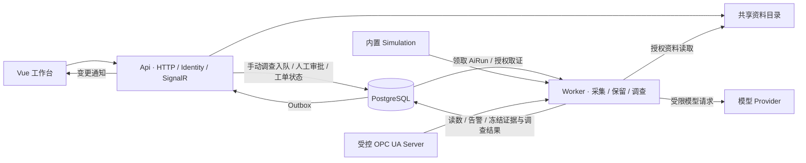

# 系统架构

本页说明当前源码的组成和跨模块约束。阶段状态和验收见 [开发计划](ROADMAP.md)，本地与容器启动见 [文档导航](docs/README.md)。

## 服务与依赖

模块化单体包含 Api 和 Worker 两个可执行 Host，共享业务库、数据库和资料存储。源码容器部署分开运行 Web、API 和 Worker，组合镜像可由 API 托管 Web 并让 Worker 与 IndustrialSim 同容器运行。当前演示按单 Worker 部署。OPC UA 连接由 Worker 建立，模型和数据库配置保存在服务端。

| 位置 | 职责 |
| --- | --- |
| `src/PlantOps.Api` | HTTP、同源身份会话、防伪、SignalR 和 Outbox 分发 |
| `src/PlantOps.Worker` | 遥测采集、保留维护和调查作业 |
| `src/PlantOps.Domain`、`src/PlantOps.Application` | 业务实体与不变量、用例契约、授权读取端口和规则 |
| `src/PlantOps.Infrastructure` | EF Core、Identity、文件存储、Simulation、入库及业务服务 |
| `src/PlantOps.Integrations.OpcUa` | SDK 隔离、Session、Subscription 和观测标准化 |
| `src/PlantOps.AI` | 调查编排、授权工具调度、输出校验和 Provider 适配 |
| `web` | Vue 3、TypeScript、Vite、Router、Pinia 和 Element Plus |

Domain 不依赖 EF Core、OPC UA 或模型 SDK。Application 定义端口，各实现由 Host 组装。Api 和 Worker 使用 .NET 10、EF Core 与 Npgsql，演示 Compose 使用 PostgreSQL 17。数据库结构由迁移管理，API 在 Development 下提供 OpenAPI，前端可据此更新生成类型。

## 采集、告警与事务

- Simulation 和 OPC UA 通过 Application 的 `IMeasurementSource` 交付标准观测，共用入库和告警管道。每个点位仅启用一个来源映射。Worker 按源管理生命周期，配置变化会重建对应来源。受控启用、白名单与故障语义见 [OPC UA 集成](docs/OPCUA_INTEGRATION.md)。
- 批次入库核对当前来源、点位及映射版本，事务内写入原始观测、最新投影、规则状态、告警变化与 Outbox。工厂级事务锁与目录/配置写入协调。重试保留事件键，重复样本不会重演规则。过载、断流与可能丢失的尾部由缺口显式表达。
- 最新观测与最后可信观测分别保留。告警由满足质量、时效、顺序条件的样本驱动，超限和恢复分别应用持续条件及回差。告警确认、恢复及工单关闭为独立业务变更。
- 原始读数按 UTC 日分区，分钟聚合由维护任务更新。原始/分钟保留默认 7/90 天，部署可以覆盖。运行时容量与可靠性的验收范围见 [P5](ROADMAP.md#3-p5opc-ua-持续采集与实时数据底座)。

## 授权、资料与实时一致性

- 同源 ASP.NET Core Identity Cookie 使用 HttpOnly/SameSite Strict，非 Development 强制 Secure。API 写请求使用 `X-CSRF-TOKEN`。业务服务读取当前角色和工厂授权，文档还受自身 ACL 限制。返回范围与业务权限见 [项目规格](PROJECT_SPEC.md)。
- 资料保存在 API 和 Worker 共享的受控目录。上传校验后生成版本，下载和调查引用通过授权路径读取。TXT/Markdown 支持片段检索，PDF 当前保存为 `NeedsText`，解析计划见 [P7](ROADMAP.md#5-p7设备知识与-rag-增强)。
- 业务更新与审计或通知按对应事务提交。API 从 Outbox 领取通知并通过 `/hubs/plant-events` 发布，测量更新可按点位合并。连接范围由服务端控制，角色、工厂授权或会话失效会中断连接。客户端以 HTTP 快照为准，利用通知刷新相关状态，重连后补查。
- Api 和 Worker 均有 `/health/live`、`/health/ready`。数据源和模型故障各自降级。调试、部署和测试使用 [开发指南](docs/DEVELOPMENT.md) 中的对应入口。

## 调查与人工动作

用户在告警详情提交调查，Worker 从 PostgreSQL 领取带租约的 AiRun。过期的运行记为失败，模型不可用时仍可采集、处理告警和手工建单。单 Worker 足以展示这条路径，也限定了本轮验证的并发与故障范围。 [队列处理](src/PlantOps.Worker/InvestigationWorker.cs) · [领取、取证与保存](src/PlantOps.Infrastructure/AI/InvestigationService.cs)

| 谁做决定 | 实际权限和可观察结果 |
| --- | --- |
| 规则与证据服务 | 按可信读数、持续时间和回差触发或恢复告警。调查固定所选告警、告警点和同设备最多两个对照点，区分事件、恢复和当前窗口，保存证据 ID、来源与 hash。 [阈值判定](src/PlantOps.Application/Alarms/ThresholdEvaluator.cs) · [可信度与异常证据判定](src/PlantOps.Application/AI/InvestigationAssessment.cs) |
| Agent | 在每轮提供的只读工具中选择补查，或直接回答。它可以检索授权规程、用新证据修正解释、保留待核查假设。预算可能使后续轮次只允许输出答案。服务端验证引用与类型化事实，原因解释和任务是否对维护人员有帮助需另作语义评审。 [调查引擎](src/PlantOps.AI/InvestigationEngine.cs) · [AI 设计](docs/AI_DESIGN.md) |
| 调查发起人与维护人员 | 有维护权限的发起人可以从已保存的调查整理建单或备注提案，核对内容并明确确认。应用服务在事务内复核权限、证据、期限、版本及内容 hash，写入工单或备注、回执和审计。其后按工单状态机记录人工处理结果。 [提案服务](src/PlantOps.Infrastructure/AI/ActionProposalService.cs) · [工单状态机](src/PlantOps.Domain/Maintenance/WorkOrder.cs) |

采集、告警、页面刷新和提案确认均不触发模型。当前架构的取舍体现在调查的每一轮请求中。冻结完整证据便于人工回查，送入模型的证据和工具仍受输入预算约束。分析一次遗漏时，需对照保存的原始证据、当轮请求实际包含的内容和最终引用。v3.14 的规程用例首轮提供了检索，模型先选测量；第二轮为最终回答预留额度，检索已无法选择。首轮选择的原因未知。 [请求与预算实录](docs/archive/P6_V3_FOLLOW_UP_20261119.md#p6-tool-budget-review-2026-11-19)

## 架构决策

| 决策 | 理由与约束 |
| --- | --- |
| ADR-001 模块化单体、两个 Host | 分离 HTTP 与后台作业生命周期。单库支持告警、提案和工单所需的事务与审计；同库和单 Worker 也是当前故障域和容量边界。 |
| ADR-002 PostgreSQL 与受控文件存储 | 关系数据、分区聚合和事务在单库完成。向量检索作为可选实验。 |
| ADR-003 规则与质量由业务后端判断 | 告警可复现，坏值和掉线不会被当作恢复。 |
| ADR-004 先只读调查，再由人工确认动作 | 缩小模型权限面，让每次业务写入可核对与审计。 |
| ADR-005 同源会话与服务端授权 | 使用 Identity 与工厂范围、文档 ACL，支持撤销已建立的访问。 |
| ADR-006 HTTP 快照、SignalR 通知与事务 Outbox | 核心状态在数据库提交。通知可能重复，失联后由客户端补查。 |
| ADR-007 共用数据源契约 | 真实协议和离线演示复用质量、规则和入库逻辑。 |
