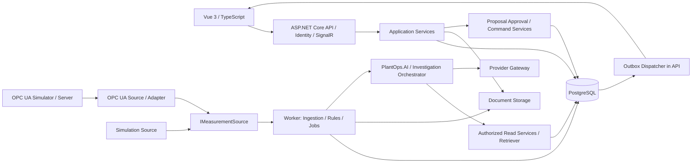

# 架构 v0.1

2026-10-09 实施顺序调整：按 [AI 演示计划](docs/plans/2026-10-09-ai-demo-acceptance.md)，下一主线直接在 P1 Simulation 上增加 P3 AI job、授权资料检索和调查，再做 P4 人工审批。完整 P2/G0 不作为 AI 前置；保留原业务服务、数据源接口与权限边界。首轮不要求 pgvector，向量/PDF/完整 OPC UA 为后续增强。本文旧阶段顺序与容量依赖以该计划为准。

2026-10-06 P2 增量：Integrations.OpcUa 固定 Client 1.5.378.182，新增节点身份/数值状态时间标准化；Application 的配置 DTO 仅含批准引用和节点参数；SamplingProfiles 保存历史修正区间，分钟支持未知覆盖率。集成库尚未注入 Worker，API 拒绝 OPC UA 启用。完整协议生命周期与容量仍待验收，详见 [P2.2 记录](docs/P2_2_VALIDATION.md)。

日期：2026-10-03。所有 ADR 状态为 Proposed，作为第一版实现默认值；变更须同步规格、实体和路线图。

## 设计原则

**AI is not the source of truth**。数据库是已提交业务状态和观测记录的权威，业务服务负责授权、校验、状态迁移和动作；OPC UA 数据源提供现场观测，发布文档提供知识证据，两者均需检查质量、时间或版本。AI 只检索、解释、提出调查假设和动作建议，不覆盖业务事实，也不直接执行写操作。

架构命名以 `PlantOps` 为核心，资产、遥测、告警和维护不依赖 AI。贯穿阶段的 [Golden Path](README.md) 为 North Plant → Utilities → Cooling Pump P-101 → vibration rise → alarm → acknowledge → work order → close；新数据源与 Copilot 在这条业务路径上增量接入。

## 1. 推荐部署与依赖



模块化单体，两个可执行 Host：Api 与 Worker。二者共享 Application / Domain / Infrastructure 库及一个数据库，不建立内部 HTTP 服务网格。OPC UA 凭据与模型密钥只给 Worker；浏览器只访问 API。P1.1/P1.2 Compose 只启动数据库，Api/Worker/前端在本机调试；完整容器部署尚未实现。

Phase 1 定义统一 `IMeasurementSource` 并实现 Simulation Source，不启动 OPC UA 或 LLM 服务。Phase 2 增加 OPC UA Source，复用同一标准化、入库、质量、规则与推送管道，Simulation Source 保留。两种源可对不同点位同时运行；同一点位仅一个启用的 SourceMapping，演示配置显式选择来源，不做自动回退或双源混写。Phase 3 才增加 Investigation Copilot、文档索引和 AI job。SignalR 推送由 API 的 Outbox Dispatcher 完成，避免 Worker 持有 Hub 连接或产生未提交消息。

## 2. 项目结构（前五个项目与 web 已创建，其余按阶段）

```text
src/
  PlantOps.Api/                 HTTP、Identity、授权、防伪、SignalR、Outbox Dispatcher
  PlantOps.Worker/              BackgroundService、采集/规则/文档索引/AI 作业
  PlantOps.Domain/              实体、状态机、值对象、业务不变量
  PlantOps.Application/         用例、DTO、端口、授权契约、事务边界
  PlantOps.Infrastructure/      EF Core、Identity、文件、Outbox、Simulation Source
  PlantOps.Integrations.OpcUa/  OPC UA Source、SDK 封装、Session、Subscription
  PlantOps.AI/                  Phase 3：调查编排、RAG、工具、Provider Gateway
web/                           Vue 3 + Vite + TypeScript + Router + Pinia
tests/                         领域、集成、契约、端到端测试
deploy/                        Compose、示例配置、模拟器配置
docs/                          领域、OPC UA 与 AI 设计
```

Domain 无 EF/OPC UA/模型 SDK 依赖；Application 依赖 Domain；Infrastructure、集成项目和 PlantOps.AI 实现 Application 端口，Host 负责组装。PlantOps.AI 依赖授权读取契约，Domain/Application 不反向依赖它；AiRun/ActionProposal 属于辅助流程，不重新定义资产或告警。按 Assets、Telemetry、Alarms、Maintenance、Knowledge、Identity 文件夹分业务模块，暂不为每模块再建四个项目。

## 3. 技术基线

| 层 | 推荐 | 约束 |
|---|---|---|
| API / Worker | .NET 10 LTS、ASP.NET Core、BackgroundService | SDK 与依赖补丁在骨架阶段锁定 |
| 数据访问 | EF Core 10 + 匹配主版本的 Npgsql provider | 全部 schema 由迁移管理，真实 PostgreSQL 做集成测试 |
| 数据库 | PostgreSQL 受支持稳定版本 | 分区和索引经负载实测；pgvector Phase 3 再装 |
| UI | Vue 3、TypeScript、Vite、Router、Pinia | API 类型由 OpenAPI 生成；表单/图表库实现时选择 |
| 实时 | SignalR | 仅通知变化；HTTP 负责权威状态与补查 |
| 身份 | ASP.NET Core Identity + 同源 Cookie | HttpOnly、Secure；写请求防伪；Development 种子 |
| OPC UA | OPC Foundation .NET Client | Adapter 隔离 SDK；稳定包版本和许可经 spike 核实 |
| AI | 自有 Provider Gateway、JSON Schema 校验 | 不依赖某模型的工具协议进入 Domain |
| 遥测 | OpenTelemetry + 结构化日志 | 本地先输出日志/指标，后续可接 collector |

Vue 官方脚手架支持 Vite 与 TypeScript，见 [Vue Quick Start](https://vuejs.org/guide/quick-start.html)。.NET 基线依据 [.NET 支持政策](https://dotnet.microsoft.com/en-us/platform/support/policy)，不沿用生命周期较短的旧版本作为新项目默认。

## 4. 模块契约与事务

| 端口/服务 | 输入 | 输出/限制 |
|---|---|---|
| IMeasurementSource | 已验证的 DataSource 与 SourceMapping、取消信号 | NormalizedSample 流及连接健康；不暴露 NodeId/SDK 类型或数据库连接 |
| IngestMeasurementBatch | 标准样本列表 | MeasurementReading、最新快照、规则状态、告警事件及 Outbox 在事务内提交 |
| AssetReadService | actor、assetId | 授权 DTO；不暴露 IQueryable 给工具 |
| TelemetryReadService | actor、pointId、UTC 范围 | 有上限的聚合/质量/缺口结果 |
| DocumentRetriever | actor、plantId、query | 仅授权且 Published 的当前版本片段 |
| ILlmGateway | Prompt、工具 schema、预算 | 模型响应、拒绝、用量与失败类型 |
| WorkOrderCommandService | actor、目标、version、幂等键 | 正常业务校验后的状态变化与审计 |

`IMeasurementSource` 定义在 PlantOps.Application，Simulation Source 实现在 Infrastructure，OPC UA Source 实现在 Integrations.OpcUa。NormalizedSample 是传输 DTO，包含 PointId、DataSourceId、SourceMappingId/Version、值/单位、质量/原始状态和时间，不包含协议节点标识；入库后成为 MeasurementReading。源实现负责协议读取与标准化，不能自行写业务表或触发 AI。

采集 Worker 每数据源单一活跃执行者；第一版只运行一个 Worker 实例。规则按点位串行处理；业务写用 version 乐观并发。规则异常时对应批次事务回滚并有限重试，错误样本隔离后登记缺口，不能为了显示新数据而跳过告警处理。

人工写操作与 AuditLog 同事务；核心状态更新与 Outbox 同事务。Dispatcher 发布后标记完成，崩溃可能重复发布，因此推送带 eventId / entityVersion，客户端去重后补查。Outbox 使用领取锁、重试与失败计数，失败不影响已提交业务数据。

P1.6 已实现：DbContext 将设备/最新测量/告警/工单/资料变化写入 Outbox；API 每秒 SKIP LOCKED 领取最多 500 条，测量合并，业务事件逐条发送。Hub 无写方法或客户端范围参数，按服务端连接授权发送，每轮检查 grants/role/stamp/启用状态并中断失效连接。文档使用配置 Documents:StorageRoot 的受控文件目录；下载在同厂锁内实时复查 ACL/发布，随机存储 key 不返回客户端。P1.7 已将 Development 默认目录改为同用户 LocalApplicationData/PlantOpsCopilot/documents，API/Worker 共用；生产必须显式配置持久存储。

P1.2 实现：Application 的 IAssetDirectory/Actor/DTO 不引用 EF 或 Identity；Infrastructure 的 AssetDirectory 实现真实角色与 UserPlantAccess 检查、关系校验和事务审计。所有目录写事务先取得工厂级 PostgreSQL advisory lock，再重新加载版本及校验树/归档关系，防止并发结构修改形成循环；不同工厂独立。SaveChanges 与 AuditLog 处于一个显式事务，版本冲突返回 409。创建工厂同时显式授权创建者；没有 Admin 范围绕过。Outbox 尚未实现，本阶段没有实时事件。

2026-10-06 通用采集整改已实现每源独立生命周期、每 500 ms 或 500 条提交（先到者触发），总队列预算 10,000、最多 200 源；有限 Simulation 每秒枚举，持续源无需结束枚举。关闭模拟只影响 Simulation，配置变化取消并重建对应源。过载丢最旧样本并登记损失，数据库离线时保留内存摘要；进程崩溃只能标记可能尾部。显式缺口由趋势、分钟和规则共同消费，见 [整改验收](docs/P1_REVIEW_FIX_VALIDATION.md)。OPC UA Adapter 尚未实现，回调应只写有界缓冲，不执行 SQL 或调用模型；容量与协议门槛仍见 [P2 计划](docs/plans/2026-10-05-p2-opcua.md)。

已发送 Outbox 增加部分索引与可选事务清理，默认关闭；启用后默认保留 24 小时、每 5 秒最多 1,000 条，SKIP LOCKED 跳过被占用行。未发送与审计保留；满量维护与容量仍须独立验收。

## 5. 数据与文件

- PostgreSQL 存关系数据、测量、最新快照、分钟聚合、作业、Outbox 和审计。原始测量按 UTC 日期分区；索引 `(point_id, effective_at DESC)`；唯一去重规则见领域模型。
- 每点位维护 LatestObserved 与 LastGood 两套引用；LatestObserved 不意味着可信。分钟聚合只用 Good 数值并保留质量数量、覆盖率和 gap 标记。
- 原始 7 天/分钟 90 天：先完成聚合再清理，重复执行可幂等；趋势超范围按聚合读取。容量不足应报警并限流，不能默默删除未聚合数据。
- 本地文件存于配置的受控目录，外部只能走授权下载 API；文件 ID 与存储 key 分离。上传先暂存并校验，再提交元数据，失败清理孤立文件。
- Phase 3 启用 pgvector：向量绑定文档版本、chunk 和 embeddingModelId；维度变更新建索引版本，不混用不同空间。
- 队列采用数据库 Job 表（Pending / Running / Succeeded / Failed / Cancelled），带租约和 attempt；Worker 崩溃后恢复过期租约。AI 动作不由重试的调查作业直接执行。

## 6. UI 与实时一致性

页面：登录、工厂/位置树、设备列表/详情、告警台、工单列表/详情、文档管理、管理员数据源/映射、告警调查面板。

首次加载 HTTP 快照；通过 `/hubs/plant-events` 接收 `MeasurementChanged`、`AlarmChanged`、`WorkOrderChanged`、`AiRunChanged`。推送只携带 ID、version 和必要摘要，测量按点位每秒合并；告警/工单不合并掉状态迁移。连接恢复后重新请求快照，不能把 SignalR 当持久事件日志。

Hub 加入工厂组必须服务端检查范围；组名由服务端生成。权限变更时断开/移除已有连接并让客户端重载，不能只在首次连接校验。Cookie 防伪适用于 HTTP 写接口；Hub 不提供业务写命令。参见 [SignalR 身份与授权](https://learn.microsoft.com/aspnet/core/signalr/authn-and-authz)。

## 7. 故障与降级

| 故障 | 处理 | 用户可见结果 |
|---|---|---|
| 数据库不可用 | 停止提交，队列有界，超限登记损失，恢复后补记 gap | API 非就绪，显示暂时不可用 |
| OPC UA 离线 | 指数退避、陈旧计时、重建订阅 | 连接状态、最后接收时间、缺口 |
| 规则处理失败 | 批次回滚/隔离，审计错误，告警引擎健康标红 | 不声称当前告警完整 |
| SignalR 离线 | HTTP 低频刷新及重连补查 | 实时连接状态 |
| PDF 解析失败 | 索引 Failed/NeedsText，可重试 | 文档仍可授权下载，AI 不检索失败版本 |
| 模型限流/超时 | 限次重试只读请求、取消/失败，不自动触发动作 | 保留证据，调查未完成 |
| 审批后条件变化 | 事务内 version/权限校验失败，409 | 要求刷新提案并重新确认 |

## 8. 架构决策记录

### ADR-001：模块化单体 + 两个 Host

**状态**：Proposed。**背景**：小团队、本地演示、采集任务与 HTTP 生命周期不同。
**决定**：共享库与数据库，Api/Worker 分进程。**备选**：单 Host 最简单但采集重启耦合；微服务独立扩展但增加网络、部署和分布式事务。
**代价**：两个进程需要健康监控和 Outbox；共享 schema 必须同步部署。达到明确容量瓶颈后再抽离服务。

### ADR-002：PostgreSQL + 文件存储 + 可选 pgvector

**状态**：Proposed。**背景**：关系业务优先，规模小，未来需要文档检索。
**决定**：先一个关系数据库，测量分区/聚合；Phase 3 加向量扩展。**备选**：SQL Server 适合现有 .NET 团队但增加演示环境差异；SQLite 部署轻但难验证并发/分区；独立时序库优化采集但增加同步和运维。
**代价**：原始测量增长快，必须做容量验收；对象存储和专用时序库是以后有实测需求时的替换点。

### ADR-003：确定性规则与质量优先

**状态**：Accepted（P1.4）。**背景**：告警应可复现、可测试，离线和坏值不能被误当恢复。
**决定**：业务规则在 Application，由 Good、新鲜、顺序有效的样本驱动；质量异常单独显示。**备选**：完全依赖 Server A&C 简化本地规则但模拟器/服务器能力不一致；AI 判告警不可确定性验收。
**代价**：需维护阈值、回差和状态；Phase 2 不做完整 OPC UA Alarms & Conditions 镜像。

### ADR-004：Investigation Copilot 先于受控 Action Copilot

**状态**：Proposed。**背景**：需要先证明读取、证据与权限可靠。
**决定**：Phase 3 围绕同一告警联合读取测量历史、告警、维护记录和文档，输出有证据的调查结果，工具保持只读；Phase 4 模型仅生成提案，人工批准后由业务服务写工单。AI is not the source of truth。**备选**：通用 Agent 可扩展但扩大权限面；纯文档聊天简单但缺少资产实时上下文。
**代价**：审批增加一步，模型输出需严格校验和审计；不提供设备控制能力。

### ADR-005：同源 Identity Cookie + 服务端资源授权

**状态**：Accepted（P1.2）。**背景**：本地业务应用无需第一版搭建外部身份平台。
**决定**：Identity、角色+工厂范围、文档 ACL；工具继承当前 actor。**备选**：OIDC 适合企业 SSO，后期迁移；自制 JWT/密码管理容易增加实现错误。
**代价**：防伪、会话撤销与实时组权限刷新必须一起实现；未来外部身份映射仍使用内部 UserId。

本阶段 Cookie HttpOnly/SameSite Strict，非 Development 强制 Secure；所有 API 写请求包括登录/退出通过 IAntiforgery 校验。SecurityStamp 每次请求校验；用例从 Identity 库读取真实角色，范围查询实时读取授权，禁用账号拒绝已有 Cookie。Health 中间件在身份验证之前，数据库故障不影响 live。无 SignalR/授权管理 UI，实时组撤销随 P1.6 实现。

### ADR-006：HTTP 快照 + SignalR 通知 + Outbox

**状态**：Proposed。**背景**：需要即时 UI，但通知可能重复或遗漏。
**决定**：事务保证事件来源，客户端去重并补查权威状态。**备选**：轮询部署简单但告警延迟；消息中间件支持分布式扩展但本版无此规模。
**代价**：需要 Outbox 清理/重试；不承诺端到端 exactly-once。

### ADR-007：统一数据源契约，持续保留模拟来源

**状态**：Accepted（P1.3 Simulation；OPC UA 留待 P2）。**背景**：需要同时支持真实协议接入、离线开发与可重复演示。
**决定**：Phase 1 定义 IMeasurementSource 并实现 Simulation Source；Phase 2 新增 OPC UA Source。两者通过 SourceMapping 连接 MeasurementPoint，共用 MeasurementReading 入库和规则服务。
**备选**：替换模拟源会让回归依赖服务器；各自建采集/告警管道会造成业务语义分叉。
**代价**：维护两种源的契约测试和类型化配置；同点位只启用一个来源，不实现自动切换。收益是无需 OPC UA/模型即可复现 Golden Path。

## 9. 验证与开放项

P1.3 实际边界：Application 定义样本/源/入库/查询端口和质量规则；Infrastructure 的 SimulationSource 不访问数据库，MeasurementIngestor 用最多 500 样本的事务写入读数与最新投影。Worker 等待每批提交，最多重试 3 次，保持事件键不变；工厂 advisory transaction lock 与资产归档、点位和来源配置共用，提交前重查启用状态及版本。配置与审计同事务，历史读数禁止 EF 修改/删除。API 不提供测量写入接口；所有查询先校验角色和资产/点位范围，配置仅允许有该厂授权的 Admin。

P1.3 当时使用未分区读数与按需统计。P1.7 已实现 UTC 日分区、含日期去重、持久分钟聚合、dirty 重算与原始 7 天/分钟 90 天保留；P1.6 已实现事务 Outbox 与 API SignalR。Simulation 的键包含映射 ID/version、来源 version、UTC 秒，重试相同批次不会重复写。最新投影和告警 ReadingId 不建读数外键，清理后保留值/质量/时间快照。100 点/30 分钟/五客户端性能与容量边界见 docs/P1_7_VALIDATION.md；协议队列/重连/变化通知覆盖率留在 P2 验证。

领域测试覆盖状态机/回差/质量；数据库集成测试覆盖事务、范围、幂等与并发；模拟器测试覆盖采集/重连；UI E2E 覆盖一次完整业务闭环；AI 评估覆盖有证据、无证据、越权与注入。性能基准见 [项目规格](PROJECT_SPEC.md)。

P1.1 已验证本地 SDK、数据库与前端版本；P1.2 已实现登录与资产目录，见验收记录。P2.1 验证 SDK API、许可、证书和模拟器；P3.1 验证 Provider 输出协议、数据发送范围、预算与 embedding 配置。当前未访问工业网络。

P1.4 实际边界：纯 ThresholdEvaluator 位于 Application；Infrastructure 在原测量事务、工厂锁内更新规则水位、告警、不可变事件与 AuditLog。去重读数不重演规则；同规则只有一个 Active 的部分唯一索引。批内恢复后先在外层事务中刷新，释放 Active 唯一槽，随后样本可再次触发；最终提交失败时全部回滚。Worker 启动清除待判计时但保留 Active；来源/点位/映射/规则版本变化也清零。样本必须在接收与实际评估时均新鲜，连续间隔不得跨过点位陈旧边界。Alarm.Version 仅在确认或恢复等业务变化递增，LastEvaluatedAt 更新不制造每秒编辑冲突。当前 HTTP 轮询，Outbox/SignalR 留待 P1.6。
