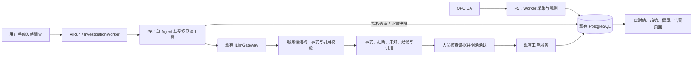

# Plant Ops Copilot 开发计划

更新日期：2026-10-21（依据用户评审修订）。评估基线：`47f4d30` 加当前工作区（含未提交及新增文件），不是仅依据 Git HEAD，也不代表运行中的部署已同步。本次仅评估代码、核对 OPC Foundation 规范和更新计划，没有实现功能、迁移数据库、启用数据源或调用模型。

本文是当前阶段状态、优先级、依赖与验收范围的唯一执行入口。`docs/plans/` 保留各次增量的设计快照；旧 P2 的剩余采集任务并入 P5，旧 P3 的调查、资料、评估待办分别并入 P6、P7、P8，不重复排期。重评前的整份路线已保存在[开发日志的历史快照](docs/DEVELOPMENT_HISTORY.md#2026-10-20-路线重评前的-roadmap-快照)，历史测试与失败记录不改写。旧文中“P3/P4 未实现”“全部常驻 OPC UA 禁用”及原 AI 优先顺序不能作为当前状态。

2026-10-21 实施增量（在上述路线重评之后）：基于 `4de521e` 完成 **P5.3 最小场景源**，92项定向检查、一次新场景真实协议有限运行及旧协议入口复验通过，见 [场景契约与验证](docs/P5_3_MINIMAL_SCENARIO.md)。仅独立测试库/schema，0模型调用，无业务数据库或部署更新；后续从 P5.1 最小证据契约继续，完整 P5 仍未验收。

## 1. 定位、边界与阶段顺序

核心定位：**基于工业实时数据、告警、设备历史和技术文档，提供有证据、可追溯、受权限约束的 AI 辅助调查。**

主流程保持：**OPC UA 数据 → 确定性规则告警 → 用户手动发起 AI 调查 → 调查结果与证据核查 → 人工确认 → 创建关联工单**。告警确认与恢复是不同状态，工单关闭也不代表设备恢复。无需 AI 的手工业务闭环继续可用。



数据更新只驱动入库、规则和页面；上图 AI 分支由用户发起的 AiRun 启动。P7 的授权文档检索接入同一只读工具与证据账本，P8 对采集场景及调查运行留存可核对记录。

- 数据采集、规则计算、SignalR 更新均不得创建调查或调用 LLM；只有用户明确发起才排入 AiRun。高频数据不消耗模型预算。
- 保留模块化单体、Api/Worker 两个 Host、现有 PostgreSQL、文件存储、Application 端口和 Vue 组件；单 Worker、每源单一生命周期。暂不增加消息中间件、独立时序库、向量数据库或 Multi-Agent。
- 工单创建/备注提案已经实现，进入维护状态。仅修复阻塞核心闭环的兼容、权限、幂等或展示缺陷；不继续扩展备注提案、跨人审批队列或专用审批/审计工作台。
- 不纳入自动调查、自动确认告警、自动执行、OPC UA Write/Call、自动根因确诊、安全结论、离线历史补采承诺。
- 七天满量、第八天滚动、90 天满量及完整工业网络/证书运维仍为延期且未验收的扩展，不能声称已通过；不阻塞有明确规模和停止条件的本机演示。外部受信加密 Server 的有限集成验证列为可选 P5.5，安排在核心演示之后，不以本机 loopback 作为长期路线终点。

| 阶段 | 当前判断 | 下一交付 | 优先级与依赖 |
|---|---|---|---|
| P1 业务底座 | 已完成且有既有验收记录 | 维护现有权限、测量、告警、工单、资料与实时通知 | 所有阶段复用 |
| P2 协议基础 | 配置/标准化/有限协议演示和受控常驻首增量已实现；完整协议运维未验收 | 剩余持续采集工作归 P5 | 不再另跑旧 P2 队列 |
| P3 只读调查 | AiRun、五工具、Tool Calling、证据账本、UI 已实现；有限真实样本已验证 | 多源分析归 P6，PDF/检索归 P7，评估归 P8 | 不重新建设 Provider/Agent 骨架 |
| P4 人工确认工单 | 创建 Draft 工单、追加备注、确认/幂等/事务审计已实现；完整浏览器审批与崩溃实验未验收 | 维持可用，仅补主路径所需验证/修复 | 不作为新功能主线 |
| **P5 持续数据底座** | 复用已实现常驻增量，先修正采样/通知/时效语义 | 最小场景、证据契约与基础故障验证先服务 P6.1；完整可靠性随后补齐 | **先交付最小链路**；P5.5 在核心 Demo 后可选 |
| **P6 多源联合调查** | 复用已有受控工具编排，突破单点/摘要限制 | 同一 OPC UA 观测用于告警和 AI；分开给出数据可信度与设备异常证据 | **不等待完整 P5**；需最小数据门槛及 P8.1 基线 |
| **P7 设备知识/RAG** | 复用文档版本/ACL/文本片段与引用 | 文本 PDF、页码引用、设备相关检索 | **P6.1 证据契约稳定即可并行启动 P7.1**；向量可选 |
| **P8 评估与可观测性** | 复用 AiRun、20 个固定案例与既有验证脚本 | 准确版本基线先行，再逐步扩充 trace、回放与对比报告 | **P8.1 最小版在 P6 改造之前**；集中验收后置 |

### 先验证 AI 价值的实施顺序

任务编号保留，按最小版/完整版拆交付，不新增一套阶段编号。最高优先级先在 P5.3/P5.1 的设计和用例中落实下文的采样、通知、时间与可信度语义。

| 顺序 | 任务切片 | 必须得到的结果 |
|---|---|---|
| 1 | P5.3 最小场景源（已交付） | 三个精确批准点位可重复呈现温度 60→75→90°C、独立振动变化及停服恢复；通知/时间戳契约与有限真实协议记录见 [P5.3 验证](docs/P5_3_MINIMAL_SCENARIO.md)。不代表完整 P5 验收 |
| 2 | P5.1 最小证据契约 | 同一套入库数据返回实时值、短期有序趋势、质量/时间、来源健康及按点位的可信度；未知字段显式未知 |
| 3 | P5.2 基础故障验证 | 验证恒值静默/恒值更新时间、Bad/陈旧、一次停服恢复、权限和现有幂等；不把无通知推成故障或物理丢样 |
| 4 | P8.1 最小运行记录 | 在改造 P6 之前记录真实 Prompt/Schema/工具/可信度策略版本、模型参数、证据 hash 与 Token 来源，形成可回放基线 |
| 5 | P6.1 最小联合调查 | 真实 OPC UA 协议观测→规则告警→用户手动调查→AI 引用实时值和趋势解释异常→核证→现有人工工单；保存首个真实模型有限样本 |
| 6 | P5.2/P5.3/P5.4 完整版 | 补全源场景和复杂时间/配置版本验证、DB/Worker 故障、30min 运行及浏览器完整验收，不减原可靠性要求 |
| 7 | P6.2–P6.4 | 优化按需工具、多点可信分析、双维度结果、UI 和既有工单兼容；最小双维度与可信门槛在 P6.1 已具备 |
| 8 | P7 与 P8 集中增强/验收 | 完成 PDF 调查、检索相关性、五场景与原安全回归、运行对比；P7.4 向量按基线收益决定 |

**并行支线**：P6.1 最小证据/引用契约稳定后，P7.1 可与完整 P5、P6.2–P6.4 并行；页码检索真正参与建议需 P7.2/P7.3 及相应引用校验完成。P5.5 等核心 Demo 与本机完整可靠性验证通过后再选做，不阻塞首个 AI 闭环。这里的并行是任务依赖关系，不要求多 Agent 或额外执行环境。

**首个端到端门槛（第 5 步）**：在独立测试数据中按声明时间线运行 2–5min（沿用每盘至少 2GiB 余量、单轮新增≤256MiB 的停止规则），同一温度点 60→75→90°C 的真实 SDK 通知进入 MeasurementReading；配置原创演示规则（例如 >80°C 持续3s、<75°C 持续5s恢复，非维修阈值）并使90°C阶段持续更新时间，保证规则触发与取证使用真实新鲜观测。一次用户发起的有限真实模型调查必须引用该点最新值、变化量/时间窗及同一告警，解释温升异常而不确诊原因。另保留 Bad 温度点与可信高振动并存的固定反例。只返回固定摘要/摘抄、只做 Fake、或另喂 AI 一套数据不算完成；尚未做的 30min/崩溃/复杂版本实验继续列为未验收。真实模型最多一次调查、零自动重试，仍遵守 4轮/8工具/16k输入/2k输出/180s 等既有限额；成功/失败均保存，不自动重跑。

该最小场景的设备观测仍为原创仿真，协议订阅/业务入库和所选真实模型调用分别核验/标记；“真实协议数据”不代表来自现场工业设备。

## 2. 代码核对与已有能力

以下为实际代码结论；验收报告中的计数是历史证据，本次未重新执行产品测试。

| 能力 | 已实现及代码依据 | 实际限制/后续归属 |
|---|---|---|
| 统一采集和业务事务 | [MeasurementWorker](src/PlantOps.Worker/MeasurementWorker.cs)、[MeasurementSourceRunner](src/PlantOps.Application/Telemetry/MeasurementSourceRunner.cs)、[MeasurementIngestor](src/PlantOps.Infrastructure/Telemetry/MeasurementIngestor.cs)：每源运行、队列总预算 10,000、500 条/500ms 批写、有限重试、幂等入库；读数/规则/告警/Outbox 同事务 | 单 Worker；进程崩溃尾部损失数未知。P5 补协议持续故障验证，不再重建管道 |
| OPC UA 多点常驻与恢复 | [RuntimeSource](src/PlantOps.Integrations.OpcUa/OpcUaRuntimeSource.cs)、[RuntimeConnector](src/PlantOps.Integrations.OpcUa/OpcUaRuntimeConnector.cs)、[RuntimePolicy](src/PlantOps.Application/Telemetry/OpcUaRuntimePolicy.cs)：每源 1–10 个精确批准节点、请求 sampling/publishing 1s、接受 1–2s 修正，显式使用 StatusValueTimestamp；Namespace URI 重解析、元数据核验、100 条通知缓冲、退避重连、重建订阅及采样区间持久化 | 当前配置标为 Periodic，不证明每秒通知或物理观测覆盖；需 P5 修正判定。仅 Development 回环/None，原加密 selftest 是独立实验；无通用远程接入或离线补采保证 |
| 质量、时间与趋势 | [OpcUaNormalizer](src/PlantOps.Integrations.OpcUa/OpcUaNormalizer.cs)、[SamplePolicy](src/PlantOps.Application/Telemetry/SamplePolicy.cs)、[TelemetryContracts](src/PlantOps.Application/Telemetry/TelemetryContracts.cs)：保存原始状态码、Source/Server/Receive 时间，EffectiveAt 依次回退；LatestObserved/LastGood、陈旧、未来时间/溢出、显式缺口、raw/已完成分钟趋势 | 原始质量/时间已有，不应再列为从零开发；需在统一调查 DTO 中完整表达回退可信度、来源版本、缺口和未完成分钟边界 |
| 连接健康与页面 | [SourceRuntimeStore](src/PlantOps.Infrastructure/Telemetry/SourceRuntimeStore.cs)、[TelemetryService](src/PlantOps.Infrastructure/Telemetry/TelemetryService.cs)、[MeasurementPanel](web/src/components/MeasurementPanel.vue)：保存连接状态、保活/接收时间、重连数和脱敏错误；10s Worker 心跳过期或来源版本变化时 IsCurrent=false；页面分开显示连接与值年龄 | Connector 的 LastKeepAliveAt 来自 session.KeepAlive，不是逐点通知或独立订阅活性证明。只有当前健康行、每源接收时间，尚缺细分观测语义；健康未进入 AI 账本 |
| 确定性告警 | [ThresholdEvaluator](src/PlantOps.Application/Alarms/ThresholdEvaluator.cs)、[AlarmBatchEvaluator](src/PlantOps.Infrastructure/Alarms/AlarmBatchEvaluator.cs)：持续/回差、Good/新鲜/连续性门槛、恢复与人工确认分离 | P5 应复验掉线/坏值不误恢复，P6 不用模型重新判定或改写规则状态 |
| AI 作业与工具 | [InvestigationService](src/PlantOps.Infrastructure/AI/InvestigationService.cs)、[InvestigationEngine](src/PlantOps.AI/InvestigationEngine.cs)、[ILlmGateway](src/PlantOps.Application/AI/LlmContracts.cs)：手动告警入口、权限复查、租约/取消、结构输出、五个只读工具、证据 hash 与授权展开；Fake/兼容 Provider/可选 SSE 已有 | 不是“尚需引入 Tool Calling”。当前预取全部五工具且计入 8 次总工具预算，模型最多再用剩余 3 次；调查主要围绕告警对应单点，不能直接支持多测点分析 |
| 调查内容 | 当前工具读取设备资料、单点最近一小时已完成分钟、近 30 天告警数量、最多五条维护摘要、当前授权文本资料 | 未发送设备各点实时值及连接健康；告警只有数量摘要；最多展开最近三条有值分钟，不能据 min/max 断言持续升温；首次资料查询硬编码 `assetCode + vibration 振动` |
| 事实与建议约束 | 当前 Prompt v5 要求最多三条整句逐字事实、固定 summary、一个弱/中等假设、两个建议；建议/假设禁数字；服务端验证引用及原句 | 适合保守摘录验收，却限制多点关联、趋势解释和规程步骤。P6 应保留事实校验，逐步增加结构化派生证据，不直接放开任意事实生成 |
| 知识与引用 | [TextDocumentParser](src/PlantOps.Application/Knowledge/TextDocumentParser.cs)、[DocumentEvidenceService](src/PlantOps.Infrastructure/Knowledge/DocumentEvidenceService.cs)、[Documents](src/PlantOps.Domain/Knowledge/Documents.cs)：TXT/MD 版本片段、标题/章节/行号/hash、当前发布版本/ACL、设备 AssetId 或工厂级关联、重新授权引用 | PDF 仅上传/保存，为 NeedsText；无页码/embedding。术语子串打分、候选最多 50 份、返回最多 6 片段；送模型的资料仅约 150 字的节选，检索相关性和完整步骤不足 |
| 人工工单收尾 | [ActionProposalService](src/PlantOps.Infrastructure/AI/ActionProposalService.cs)、[ActionProposalPanel](web/src/components/ActionProposalPanel.vue)：成功调查整理模板，无额外模型调用；编辑/完整核对/15 分钟期限/事务重授权/版本 hash/并发幂等/执行回执 | 创建与备注均已实现。后续只保证调查 schema 演进兼容现有模板与回执，不再排新的审批功能 |
| 运行与评估 | [AiRun](src/PlantOps.Domain/AI/AiRun.cs) 已存起止时间、状态、失败码、模型、轮数/工具数、证据/结果与 Token 字段；已有 [20 场景测试](tests/PlantOps.Tests/InvestigationScenarioTests.cs) 和 [真实质量测试](tests/PlantOps.Tests/InvestigationRealQualityTests.cs) | AiRun.PromptVersion 默认仍为 extractive-v1，实际 Engine 为 v5，创建/完成未同步；Token 字段存预算核算值，可能含未知 usage 预留。缺逐轮/逐工具记录、准确版本与策略快照、实际/估算用量区分、对比报告 |

既有验证边界：P1 见[整体验收](docs/P1_7_VALIDATION.md)；OPC UA 常驻三点停服/Namespace 重排已两次验证，但单轮约半分钟，不能当作长期可靠性；历史完整后端 516 通过/3 条件跳过，之后定向 83 通过，前端 30 通过，详见[运行记录](docs/OPCUA_RUNTIME_VALIDATION.md)。AI 已有 20 个确定性场景及五个代表真实样本的有限语义复核；其中原自动结果为四通过、一项关键词检查失败后离线复核通过，不能称完整真实套件全绿，见[真实质量记录](docs/AI_REAL_QUALITY_VALIDATION.md)。P4 见[创建工单](docs/P4_WORK_ORDER_VALIDATION.md)与[备注](docs/P4_NOTE_VALIDATION.md)：核心已实现，完整审批浏览器 E2E/崩溃恢复仍未验收。

## 3. P5：OPC UA 持续采集与实时数据底座

**阶段结果**：一个受控本机多点 OPC UA 来源可以持续运行、解释失败并恢复；同一组设备读数驱动页面、趋势、规则和 AI 证据。沿用当前 1–10 点/源边界，首轮用同设备三个点（两路温度及振动）。先交最小数据链路支持 P6.1，再完成本节完整验收；外部安全连接另列可选 P5.5，不直接扩至 100 点或完整工业网络运维。

### 已有与缺口影响

已有多点配置、订阅、重连、采样修正区间、质量/时间标准化、连接健康 API/UI，以及共用入库/规则链路。最高优先级缺口是未充分区分采样、通知、源时间与可支持结论的观测覆盖；现有 Periodic 标记/按间隔推导缺口可能高估能力。其他缺口为持续运行和数据库/Worker 故障实测、不同温度/振动场景、P6 统一证据契约；当前健康行不能证明任意历史健康。现有 Compose 不加载该模式，不能把容器 loopback 当宿主模拟器。

### 推荐任务与依赖

| 顺序/任务 | 优先级 | 内容与复用模块 | 依赖与完成产物 |
|---|---|---|---|
| P5.1 调查证据数据契约 | 最高 | 最小版先用既有 Points/Trend/Sources/读数返回实时值、有序短窗、质量、时间/通知/健康语义、按点位可信度及原因；未知元数据显式未知。完整版补齐复杂版本历史、投影元数据与完整窗口特征 | 最小 P5.3 后即做，不以全部 DTO/迁移设计完成为前置；最小语义/权限/引用与预算须先成立 |
| P5.2 故障可靠性与最小观测 | 最高，分两次交付 | 基础版验证恒值更新时间与静默、Bad/陈旧、一次停服恢复、幂等/权限，并修正无通知误报/覆盖误算。完整版扩展 DB 暂停、Worker 强停、重建/取消/版本屏障、缓冲溢出及脱敏指标 | 基础版在 P6.1 前；完整故障矩阵在首个 AI Demo 后。复用 Runtime/Runner/Worker/SamplePolicy/SamplingCoverage，不建立第二套管道 |
| P5.3 可重复工业场景源 | 最高，首先做最小版 | 扩展现有 `spikes/PlantOps.OpcUa.Spike/SimulatorServer.cs`/`RuntimeExperiment.cs`：先供温度 60→75→90°C、不同振动变化及停服；再补恒值+更新时间、恒值+按变化报告、冻结/缺时/Namespace 与复杂质量场景 | 最小版先于 P5.1；复用已实现 Adapter/测量/规则及独立运行器，声明通知契约，不改旧 Simulation GoldenPath 或伪造业务历史 |
| P5.4 持续验收与统一展示 | 高，首个 AI Demo 后 | 复用 MeasurementPanel、TelemetryConfiguration、Overview 和告警页；补语义/原因/时间定位、30min 联合运行及完整浏览器路径 | P5.1–P5.3 完整版；首个 P6.1 无需等待此门槛，但不能据最小闭环声称 P5 完成 |
| P5.5 外部 OPC UA Server 集成验证 | 可选，核心 Demo 后 | 复用采集 Adapter 连接独立部署、部署批准的远程安全 Server；显式安全策略/身份校验、证书信任、订阅/重连与质量取证 | 核心 P5/P6 Demo 和本机完整可靠性通过；独立门槛见下节，不直接放开现有 loopback/None 限制 |

### 采样、通知与观测新鲜度（最高优先级）

SamplingInterval 是 Server 对数据源的尽力采样节奏，PublishingInterval 是订阅的发布节奏；它们都不是逐点通知频率承诺。无过滤器默认 STATUS_VALUE；当前代码明确请求 STATUS_VALUE_TIMESTAMP、未设置 deadband，只有状态/值/SourceTimestamp 的相关变化才可能形成通知，不能据此保证每秒一条，单独 ServerTimestamp 更新也不满足该触发条件。依据 [Part 4 Sampling interval](https://reference.opcfoundation.org/specs/OPC-10000-4/5.13.1.2)、[DataChangeTrigger](https://reference.opcfoundation.org/specs/OPC-10000-4/7.10)和[DataChangeFilter](https://reference.opcfoundation.org/specs/OPC-10000-4/7.22.2)。

Subscription KeepAlive 只能支持订阅仍活跃的判断，不携带新测量；当前 Connector 还只记录 Session 保活，不能将其冒充订阅或设备观测更新，见 [Subscription model](https://reference.opcfoundation.org/specs/OPC-10000-4/5.14.1)。SourceTimestamp 可表示值/状态最后变化时刻；ServerTimestamp 是服务器收到或确认值准确的时间，均需结合源行为理解，不能把旧源时间一律称作冻结故障，见 [SourceTimestamp](https://reference.opcfoundation.org/specs/OPC-10000-4/7.11.3)及[ServerTimestamp](https://reference.opcfoundation.org/specs/OPC-10000-4/7.11.4)。以下判定规则为本项目的设计决定，而非规范自动提供的业务可信结论。

| 概念 | 依据与范围 | 不得推导的结论 |
|---|---|---|
| ConnectionHealthy | 分开保留 Session/Subscription 状态与最近成功活动、Worker 健康更新时间；缺订阅活性证据时该部分 Unknown | 连接活着≠某点有新通知，Worker 心跳≠协议保活 |
| NotificationFresh | 本 point 最近 DataChange 的实际接收时间与阈值，不拿每源 LastReceivedAt 替代；重复通知可以刷新接收状态但不能伪造新源观测 | 最近无通知≠断线、物理丢样或传感器故障；其他点活跃≠本点活跃 |
| SourceTimestampFresh | 原始源时间年龄、是否前进、时钟异常及该点的时间语义；缺时间返回 Unknown | 源时间新≠值变化或独立证实现场；源时间旧≠设备异常 |
| ValueChanged | 声明比较窗口内、同单位/配置身份的有效值是否变化；历史不足时 Unknown | false≠异常、冻结或采集故障；true 也不能忽略 Bad/陈旧 |
| DataTrustworthy | 后端按 point、窗口和待支持的结论计算可用性/原因，综合质量、时间语义、来源版本和可证明的覆盖 | 不是 LLM 自行打分，不以一个点坏否定全部点，也不把“可引用历史事实”等同“足够判断当前状态” |

不强制新建五个数据库字段；使用带原始时间/依据/原因的 DTO 和必要运行元数据。前四项允许 Unknown/NotApplicable，DataTrustworthy 采用下节的数据可信度枚举。没有近期确认时表达“当前观测无法确认”，不得默认传感器损坏。

通知与覆盖策略最小版即要明确：记录 requested/revised sampling/publishing、trigger/deadband、点位时间戳语义，以及 `周期更新已验证 / 按变化报告 / 未知` 的观测契约；这是业务观测契约，不用当前 SamplingMode=Periodic 代替。仅在受控源承诺并实测周期更新时间/报告后按该契约核对预期通知；按变化或未知来源的覆盖率返回 unknown，不以窗口÷SamplingInterval 反推物理样本数。无通知形成“无近期确认”的显示区间，不直接写成确定丢失 IngestionGap；已有明确断线、overflow、缓冲丢弃仍保留其确定/可能范围与原因。规则持续性不能跨不可验证区间；保持 Active 且不触发 LLM。

最小 Demo 使用显式周期更新时间的三个仿真节点，并同时验证按变化报告的恒值反例；不为了得到 1Hz 图线填补观测。如以后需要受限 Read 确认，仅对批准点位按独立频率/数量限额读取，保留 Read 来源及原始时间；Read/收到响应同样不等于传感器刚完成物理采样。首个闭环不以实现该补充路径为条件。

### 关键技术决定（ADR-P5，计划决定）

- **采集可靠性**：继续每源单一连接/串行重连，重建 Session/Subscription 后重验 Namespace URI、节点元数据并先落 SamplingRevision 再放样本。恢复不补造离线观测；失败期间登记确定或可能缺口，不承诺 Republish/历史补采。保留现有退避上限及配置/安全错误锁定策略，避免在演示阶段同时实现会话迁移。
- **质量与时间**：保留原始三种时间/StatusCode 和既有 EffectiveAt 的 Source → Server → Receive 排序回退；另外表达通知接收、源时间年龄及适用结论，不能把 EffectiveAt 回退顺序当成完整可信度算法。Bad/Uncertain、溢出、时间异常和不可确认的观测不能支撑当前可信结论或恢复告警。恒值无通知/源时间不动时按观测契约解释，不能自动确诊冻结；各点质量与时效分别判断，缺失/未知不填零。
- **连接与值分开**：沿用 SourceHealth.IsCurrent 的 10s Worker 心跳门槛；通知、源时间和确认有效期分别说明，先复用 StaleAfterMs 作为展示预算，不能将其冒充源的周期通知保证。Connected/Session 保活、Subscription 活性、逐点观测独立取证。复用当前健康快照和已有明确 gap/采样区间，不新增全量心跳历史表；历史未知明确标示。
- **配置与历史来源**：当前 MeasurementReading 保留 mappingVersion，未持久化 SourceVersion，PointLatestState 也无完整来源快照。最小版记录取证时当前配置、观测的已有身份和缺失原因；不支持或版本无法核对的证据降级，不回填历史。完整版为新观测补最小不可变来源版本/投影元数据、验证切换屏障；不以所有历史版本改造完成阻塞首个固定配置 Demo。
- **部署边界**：核心 Demo 继续普通本机 Api/Worker、显式批准来源/节点，None 仍仅限 Development loopback；P5.5 单独验证部署批准的外部加密路线，不放开现有本机 None 策略，也不默认允许任意地址。

数据处理采用以下显式策略，P5.1/P5.2 在 SamplePolicy、规则读取和调查读取中核对一致性；其中时间可信度的细分是新增待办，不能算当前代码已支持：

| 情况 | 当前值/趋势处理 | 告警与调查处理 |
|---|---|---|
| Good、时间含义/新鲜度已确认、配置身份匹配 | 可作为截至取证时、声明范围内的可信观测；保留原始时间/单位/来源 | 规则按连续观测门槛处理；AI 可引用事实，仍不能确定根因或全设备安全 |
| Bad / Uncertain / 溢出 / 时间异常 | 保留观测与原因，不能覆盖 LastGood 或连接为连续可信趋势 | 中断对应连续性判定，不凭坏值确认设备异常或恢复；AI 强制提示不可验证 |
| 无近期通知/有效确认、配置不匹配 | 保留值及年龄，标“当前观测无法确认”；曲线缺观测不自动登记物理丢样，不补零/补历史 | 缺可验证连续观测时不推进阈值计时或清除 Active；仅该点相关结论不足，不否定其他可信点 |
| SourceTimestamp 缺失，仅 ServerTimestamp 有效 | 继续按服务器时间排序和判断该时间的新鲜度，标记 Server 回退 | 不宣称有设备源时间；可用性与局限随引用展示，不能声称物理采样时刻已证实 |
| Source/Server 均缺失，仅 ReceivedAt 可用 | 保留入库顺序和接收新鲜度，设备观测时效标未知 | 对 OPC UA 不凭仅接收时间的样本推进持续告警/恢复；P5 补此时间可信门槛及回归，AI 不将其当可靠实时值 |
| 恒值/源时间不动、连接正常 | 周期更新时间契约被违反时提示观测中断待核实；按变化/未知契约显示没有近期确认；Server 确认时间另列 | 不仅因 ValueChanged=false、SourceTimestampFresh=false 就报传感器故障；不抹掉其他点的设备异常证据 |
| Worker 心跳过期、Session/Subscription 异常 | 分别标未知/异常及原始时间；旧 LastGood 不变成新值 | 陈述可证明的链路问题，不能把未确认值当当前正常；不自动触发模型 |

### P5 → P6 必交付的证据契约

不另建 AI 专用时序库；UI 与调查都通过相同业务读取和可信性规则消费既有存储。下列是**待实施的契约**，不是声称当前 DTO 已完整提供。

| 证据组 | 必须返回 | P6 如何使用 |
|---|---|---|
| 设备及点位清单 | 固定 plant/asset、pointId/code/quantity/unit、启用状态、source/mapping ID 与版本；最多 10 个调查点，超出明确说明覆盖范围 | 建立点位 allowlist，支持温度/振动联合调查；来源配置状态不等于设备物理运行状态 |
| 最新观测与 LastGood | readingId、值/单位、原始质量/三种时间/EffectiveAt、TimestampOrigin、异常/年龄、逐点通知时间；五个观测概念、可信级别/原因/可用范围与策略版本 | 历史与截至取证时的当前证据分开；无新通知不能据此确诊故障，LastGood 只在适用时效内支撑相应结论 |
| 有序趋势与派生统计 | UTC 窗口/分辨率、有序有效值/分钟、min/max/avg、首末值/变化量/率、质量数、观测契约和 coverageBasis/unknown、采样区间及显式 gap | 先用 raw 短窗给最小升温证据；统计范围只称已入库观测。按变化/未知契约不从 sampling 倒推完整率，不跨不可验证段算连续趋势 |
| 来源健康 | sourceId/取证时配置版本、Worker 状态/时间、Session/Subscription 活性依据、逐点通知状态、重连数/固定错误分类；未支持项 Unknown | 连接异常与有效测量可以同时存在于不同点/窗口；当前健康不能外推整段历史 |
| 告警/设备历史引用 | 告警 ID、pointId、触发/恢复/确认时间、规则/触发快照；维护记录 ID、状态、发生时间与结果摘要 | 将趋势窗口对应到具体告警和既有维护；没有维护记录不等于从未维护 |
| 证据封装 | schemaVersion、asOf/checkedAt/retrievedAt、资源/版本、查询范围、来源种类/仿真标记、hash、截断/缺失/失败原因 | P6 登记稳定 evidenceId，输出引用可授权展开；P8 保存快照与版本用于回放 |

最新值+来源健康在一次短数据库快照中读取，捕获明确 asOf；趋势也带自己的查询/聚合水位，不能将多次查询伪装成现场原子快照。分钟仅用已完成且聚合可确认的桶，当前分钟用有上限 raw 窗口解释；缺桶/dirty 未完成显示未知。后续模型调用不持有数据库事务或工厂锁。

最小版先覆盖同设备三个点、实时值及最近≤5min raw 的变化事实、质量/连接与已选告警；其余历史元数据/分钟派生字段可缺失并给原因。安全、引用、窗口、可信度语义和原始时间不可省略；完整 SourceVersion 历史、全部窗口特征及复杂跨版本实验属于完整版，不成为 P6.1 的隐性前置。

默认调查最多 10 点、最近 1h 分钟、短期 raw 最多 5min；读取服务对行数/响应体设上限。给模型优先送摘要，原始序列保留为可展开证据；不能把 10 点整小时 raw 一次灌入 16k 输入预算。具体 DTO 命名在实施时决定，权限和时间语义本阶段固定。

运行观测首轮只补必要项：每源连接状态/重连数、最后通知时间、通知/Worker 队列深度与溢出次数、入库批次成功/失败/延迟、可能损失/gap 数。连接心跳、收到通知、写入成功分别计时；健康表写入成功不能冒充数据已入库。精确损失条数只有可证明时记录，崩溃/协议空窗保持未知。

### 基础门槛与完整验收标准

**P6.1 前的基础门槛**：最小三点场景可实际订阅/入库/触发规则；新鲜度概念、按点位可信度及引用可核对；验证恒值更新时间、按变化恒值静默、Bad 与可信高振动并存、一次停服恢复、未授权读取和重复通知。明确不能证明当前状态时输出未知；阶段表的首个 AI 闭环可立即执行，不等下面完整矩阵。

**P5 完整验收**（首个 AI 闭环之后补齐，P5.5 另行可选）：

1. 复用现有短脚本重放断线/Namespace 基线，再在独立 `plantops_tests` schema 运行 **3 点 × 请求 sampling/publishing 1s × 30min**；校验映射、单位和 Server 修正参数。周期时间戳场景按模拟器实际生成/满足过滤条件的通知序列核对入库和重复，记录能力前提，不直接用 3×1Hz×时间推物理样本数。按变化/未知场景可合法静默，coverage=unknown，不因未达理论 5,400 条判失败。
2. 同轮注入至少三次停服/恢复及一次 Namespace 重排；重连无并行风暴、无旧会话关闭新区间。停服后 20s 内可见 Reconnecting/未知健康，测点超过自身阈值后陈旧；Server 恢复后 60s 内出现新鲜样本（本机目标，记录实际耗时与版本）。旧 gap 可定位/闭合，离线时不能自动恢复活动告警。
3. 测试矩阵必须区分：恒值但源时间推进、恒值且 STATUS_VALUE 静默、STATUS_VALUE_TIMESTAMP 下恒值/源时间均不变、仅 ServerTimestamp 更新、已声明周期更新但实际停止、订阅停止而 Session 仍活跃、真实断线；预期各自核对五概念。前四种不能自动报传感器故障；周期契约违背只说明观测不再被确认，不确诊硬件。再覆盖 Bad/Uncertain/未来/缺时/overflow/缓冲满/重复，坏值不覆盖 LastGood，覆盖和损失不编造，逐点与每源接收不混用。
4. DB 暂停及 Worker 强停/重启单独执行：队列保持有界；恢复继续采集，已提交业务状态仍在；不完整尾部标可能缺口。Worker 停止超过 10s 后 API 不仍声称健康当前。安全/元数据错误进入 Faulted 且不降级；修复配置后可恢复。
5. 在浏览器核对三点实时值/raw/分钟、健康、告警触发与恢复；授权读取与越权拒绝均通过。P5.1 的相同数据可由有 actor 的调查读取服务获取并逐项对照数据库/API；采集、告警、刷新全程 **新增 AiRun=0、模型请求=0**。
6. 运行前声明机器/频率/时长/磁盘预算与停止条件，复用现有至少 2GiB 余量、单轮每盘新增不超过 256MiB 的有限实验规则；这些是验收运行器待补齐的检查，不是现有产品硬配额。保存成功和失败报告，不清理旧数据换空间。

**阶段 Demo**：启动同设备两温度点与振动点 → 温升产生告警 → 停 Server，连接失败/当前观测不可确认且不误恢复告警 → 重启并重排 Namespace，映射恢复且 gap 保留 → 人工确认并用现有入口创建关联工单；另外展示恒值静默与故障的区别。该 Demo 可独立不调用模型；跨阶段的新 AI Demo 按第 5 步提前执行，不等待这里的完整可靠性验收。

### P5.5：外部 OPC UA Server 集成验证（可选）

**目标/依赖**：核心 P5/P6 闭环与本机完整可靠性通过后，使用同一 Worker/Adapter/入库/规则/证据路径连接另一主机、VM 或独立容器网络中部署的受信 OPC UA Server。现有加密 selftest 只证明隔离协议能力，不计此里程碑完成。

**设计决定**：独立显式启用外部安全验证模式，部署端批准具体 endpoint、ApplicationUri、Namespace/节点和证书信任目录；选择显式受支持的 SignAndEncrypt 安全策略（首个候选沿用已验证的 Basic256Sha256，实施时核实目标能力），验证证书信任/有效期/端点及应用身份。不自动信任证书、不降级 None、不放行任意发现重定向；匿名只读若 Server 允许即可，否则凭据仅走受控配置。人工安装/撤销公钥即可，不建设完整证书管理平台。网络开放仅按批准目标，不修改现有本机 None 的限制。

**可验证验收**：在受控隔离环境连接 2–3 个批准点至少 10min，采集、质量/时间/观测契约、健康与授权读取均可核对；强制断网/重启 Server 至少一次，订阅重建/恢复可见且不承诺离线无损；首次不受信证书、错误应用身份及证书失效均拒绝，人工批准正确证书后成功。撤销本地信任或更换证书后，重建连接必须拒绝未重新批准的身份，人工重新核准后恢复；不要求本轮实现在线全套撤销服务/热更新。保存安全模式/策略/证书指纹与日志，不保存私钥/凭据。

**Demo**：外部加密 Server → 既有趋势/规则告警 → 用户手动调查并展开同来源证据 → 断网/恢复及重新核对。无需新增业务写工具、Agent 或数据库；只证明有限外部安全接入，不冒充完整工业网络、HA 或生产证书运维验收。

## 4. P6：AI 多源联合调查增强

**阶段结果**：用户从同一告警手动发起，AI 可按需联合当前值、趋势、相关告警、来源健康、维护和已授权资料，明确事实/推断/未知/建议，同时独立表达“数据可信度”和“设备异常证据”；结论可回查测点、数值、窗口、告警和来源。先交 P6.1 最小分析而非只摘录证据；P7.1 可随后并行，未完成 PDF 时继续用 TXT/Markdown。

### 已有与缺口影响

已有单 Agent 的工具协议、ILlmGateway、有界编排、授权/取消/租约、账本和保守输出校验，适合渐进演进。瓶颈是“全五工具预取 + 单告警测点分钟 min/max + 告警计数 + 固定振动检索 + 摘录式输出”，不是缺少 Agent 框架。当前缺多点趋势、细分时效和双维度判断；设备异常与采集异常可能同时发生。固定 summary 与三条原句不能证明实际分析能力，也不能为了等全部可靠性增强而延后第一次验证。

### 推荐任务与依赖

| 顺序/任务 | 优先级 | 内容与涉及模块 | 依赖与产物 |
|---|---|---|---|
| P6.1 最小联合调查 | 最高，先验证 AI 价值 | 接入最小 P5 三点数据/短窗派生事实/具体告警、后端可信度及异常证据范围；温升回答须解释变化与规则告警并引用，而不只列事实。小范围版本化放开必要解释限制；去掉首次检索固定振动词，复用现有工具/工单 | 仅需最小 P5.3/P5.1、基础 P5.2 与先行 P8.1；不等完整 P5。保留严格事实/引用/权限校验，先交真实模型有限样本和固定反例 |
| P6.2 按需只读取证 | 高 | 复用 Engine/Gateway，初始只供所选告警、设备/点位摘要和强制质量/连接警告；较详细趋势、相关告警、维护、资料按需读。保留现有工具名或版本化新增 schema，不重建工具系统 | P6.1；冻结点位 allowlist、时间/大小限额、工具失败反馈、去重/缓存、逐调用追踪 |
| P6.3 可核查的联合分析 | 高 | 扩展 P6.1 的双维度与局部有效分析，补多点支持/反证/核实步骤、缺失信息和规程建议；数字/单位/时间及派生事实继续校验 | P6.1/P6.2 与完整 P5 适用用例；不把双维度或最基本温升解释拖到本任务才首次出现 |
| P6.4 页面、工单兼容与有限真实验收 | 高 | InvestigationPanel 展示证据时间/质量/来源及事实/推断/未知/建议，引用定位到测点、窗口、告警或资料；核对现有 ActionProposal 模板与 schema 升级兼容 | P6.3；Fake/协议/真实质量分别报告，完成用户手动调查→核证→确认 Draft 工单路径 |

### 双维度判断与部分有效证据

最小版先在证据/服务端结果元数据中表达，后续按版本扩展 UI，不要求先做复杂结果工作台。

| 维度 | 允许状态 | 决定依据及职责 |
|---|---|---|
| 数据可信度 | 可信 / 部分可信 / 不可验证 | 后端按测点、窗口、适用结论计算，输出质量/通知/时间含义/来源健康/身份与覆盖原因及策略版本；LLM 只解释，不得重写可信标签 |
| 设备异常证据 | 存在 / 未发现 / 证据不足 | 从可信测量、可重算趋势/阈值、告警时间及历史中分析，引用具体证据；服务端验证范围与支持条件。表示异常证据，不表示已确诊根因或安全结论 |

可信度先逐点/窗口给出，再汇总并列出已覆盖/未覆盖点；不使用“一点失败全设备失败”的全局布尔门槛。某个点只能支撑历史事实时也要写清，不得支撑“当前正常”。“未发现”仅针对已检查且足够的范围；关键点缺失时整体应为“证据不足”，不能等同“设备正常”。存在可信异常证据时，即使其他点不可验证，也不能将结论整体降成“没有设备异常”。仅历史 Active/Recovered 告警而无当前可信观测，不能单独确认当前设备异常。

| 固定反例 | 数据可信度 | 设备异常证据与可接受回答 |
|---|---|---|
| 温度 Bad，振动 Good/新鲜且超限 | 部分可信 | 存在：引用振动读数/窗口/规则，温度不可验证；根因待核查，不能因温度坏否定振动异常 |
| 各点都无近期有效确认，旧告警仍 Active | 不可验证 | 当前证据不足：历史触发可查，但当前设备状况不能确定，优先核查采集 |
| 周期契约明确的三个点有效、趋势稳定且无当前超限 | 可信（限该窗口/点集） | 未发现：限已核查范围，不承诺设备绝对正常 |
| 按变化报告的恒温点静默，另一点新鲜正常 | 对当前全点覆盖为部分可信或不可验证，按依据给出 | 不把静默当温度传感器故障；温度当前确认不足，保留另一点的有效事实 |

### 关键技术决定（ADR-P6，计划决定）

- **继续单 Agent 的受控 Tool Calling**。现有架构已适用，无需引入多 Agent、LangChain 或独立编排服务。保留最多 4 模型轮、8 次工具调用、16k 输入/2k 输出、单工具 5s、单请求 120s/整次 180s 上限；初始服务端取证也计入工具预算。通过减少固定预取和重复上下文腾出预算，不直接扩大限额。
- **固定资源范围，参数只允许收窄**。actor/plant/asset 不由模型指定；pointId 必须来自本次服务端登记的设备点位列表，窗口用受限 lookback/分辨率或服务端验证的 UTC 范围，不能越过 asOf；禁止任意 SQL/URL/文件/写工具。保留调用前后、结果保存及引用展开的重新授权，撤权或资料换版后隐藏旧受限内容。沿用最多 40 个账本条目，首轮最多 10 点最新值摘要及 3 点详细趋势，其余按需/截断明确提示；优先证据选择规则和每工具响应上限在实现时一并回归，不能只控制调用次数却放任正文超预算。
- **确定性计算与模型解释分工**。服务端生成首末值、变化量/率、连续上升段、质量/缺口、告警时间对应等可重算事实；稀疏 min/max 不算持续趋势，跨缺口不能计算连续升温，多点同时变化不等于已确认共同根因。设备目录启用/归档、告警状态、来源连接均不能冒充物理运行状态；没有运行反馈点时写未知。
- **演进输出但不放松可追溯性**。P8.1 先准确记录基线；P6.1 即允许基于可重算温升事实、告警及双维度标签的必要解释，不能继续只验固定 summary/三条摘录。事实与 derivedFact 的数字/单位/窗口/算法版本仍由服务端校验，模型不自算无证据数值，推断只作待验证。后续 P6.3 再扩表达及规程建议。InvestigationResult 按版本演进，P6.1 最小版也须兼容旧结果与 ActionProposal 模板/回执/hash，不将兼容工作全部拖到 P6.4，不增加审批功能。
- **固定取证窗口与真实取数时刻**。每次运行记录 asOf，首次最新值/健康捕获成不可变快照；后续趋势/事件不越过此截止，引用带真实 RetrievedAt/聚合水位。相同工具参数命中同一证据快照，去重键须含点位、窗口、分辨率、配置/内容版本，替换目前过粗的 kind/resource/version 去重。新增工具警告同时进入账本和最终 UI，不能只在首次预取时建 DataQuality。不为了冻结时间跨 LLM 持锁；重试生成新 attempt 并标明证据变化。
- **部分失败按点位/结论降级**。质量/新鲜度/覆盖由后端判定；缺失点/资料只限制依赖它的结论，不否定其他可信异常。数据可信度与设备异常证据可以同时为“部分可信/存在”，无足够证据时不能确诊根因或全设备正常。授权、schema、引用或预算失败仍终止运行。历史调查显示“截至取证时间”及后续过期提示，不改写账本伪装实时。

### 可执行验收标准

1. 同一 P5 运行的温度/振动 readingId、分钟/短期 raw 窗口、告警 ID、source/mapping 版本、健康/陈旧证据进入账本，可授权展开并与数据库逐项相符；无需再复制另一套仿真数据给 AI。
2. 持续升温场景必须引用有序趋势/服务端计算的变化特征及对应温度告警，不能只复述单个最大值；多点场景至少使用两个测点证据，明确共同变化与潜在原因的区别。
3. 分别验证连接断开、订阅失活但 Session 正常、Worker 心跳失联、周期契约违背与合法恒值静默：按后端五概念/原因解释，不把无通知或源时间不动直接写成传感器损坏，不把旧 LastGood/KeepAlive 当新测量，也不将其他有效点证据丢弃。
4. 正常场景使用已恢复历史告警作为现有人工入口，当前数据 Good/新鲜且趋势稳定，说明历史告警与当前状况不同，不凭空新增异常或故障原因。完全无告警的设备调查入口不纳入首轮，验收不得为凑入口制造业务告警。
5. 跨厂/其他用户运行、非法 pointId/范围、文档注入、伪造事实/引用及权限变化均被已有边界拒绝；工具超时、缺资料、预算/取消不会产生工单或改变告警。模型业务写工具数始终为 0。
6. 工具 trace 证明至少一项缺失信息能触发模型按需读取并回到有效答案；另有无需额外工具即可结束的例子，不能机械要求每次调用工具。重复取证不重复注入正文，初始+按需总数不超过 8，事实/引用覆盖 100%，强制数据警告保留 100%。
7. 用户核证后才可通过既有 P4 创建关联 Draft 工单；不确认/拒绝/重复确认/返回不明的既有保护仍有效。完整浏览器主路径在隔离测试数据上验收，真实模型只做预先界定场景/次数/Token 的有限抽查，记录所有失败；本次计划更新不运行这些调用。
8. P6.1 的首个温升回答含最新值、具体变化/时间窗、关联告警及“异常证据存在、原因待核查”的解释；Fake/原句照抄不能替代真实语义验收。双维度固定反例全部通过：温度 Bad+可信高振动必须“部分可信/存在”，所有当前点不可验证为“不可验证/证据不足”，可信稳定为限定范围“可信/未发现”；可信标签不得被模型改写，缺少关键点时不得无依据声称全设备正常。

**阶段 Demo**：两温度点连续上升、振动伴随变化 → 确定性告警 → 用户手动调查 → 初始上下文提示时效，AI 按需读取趋势与相关告警/维护 → 展示测量事实、可能原因、反证/未知和核查建议 → 用户点击证据回到具体测点/时间段 → 手动确认并创建 Draft 工单。另演示先停 Server 再调查：结果优先指出采集异常并要求核实数据，不误认设备已恢复。

## 5. P7：设备知识与 RAG 增强

**阶段结果**：可靠的文本 PDF 规程以设备/版本/页码参与同一调查，能定位、重授权并明确不足；不一次建设复杂 RAG 平台。

### 已有与缺口影响

已有上传/版本/发布/撤回/ACL、AssetId 或工厂级资料、TXT/MD 分段/hash/行号和引用展开；这些直接复用。缺 PDF 文本与页码、设备型号/症状相关排序和足够的模型证据片段；全局 `text-v1` 相等判断不支持多解析器，查询中的旧文本补索引不适合承载重 PDF 解析。现有按术语子串打分可用作基线，但中文连续词、简称及设备专用性可能漏召回，未经评测不能保证引入向量就更好。

### 推荐任务与依赖

| 顺序/任务 | 优先级 | 内容与涉及模块 | 依赖与产物 |
|---|---|---|---|
| P7.1 文本 PDF 索引与定位 | 高，提前并行 | 扩展 Knowledge 解析端口、DocumentVersion/Chunk、Worker 索引任务；保留 TXT/MD，增加文本 PDF、物理页码/页范围、章节、parserVersion/hash。选择适合当前部署的解析库，核实许可和提取样本 | P6.1 最小证据/引用契约稳定即可启动，与完整 P5/P6.2–P6.4 并行；不等 P6.4 或完整新 UI，不提前建向量设施 |
| P7.2 设备/故障相关检索 | 高 | 先复用现有 AssetId 关联、标题/章节/类型和关键词；同设备资料优先，工厂通用资料补充，按真实 quantity/告警现象生成查询，增加受控中文同义词和去重 | P7.1；若型号字段不足先使用可验证标签，不强建知识图谱/复杂多对多关系 |
| P7.3 规程参与调查与授权引用 | 高 | 扩展 DocumentEvidence/Investigation evidence 和引用 UI，按 Token 预算提供完整相关段落而非固定 150 字；服务端生成页码定位/授权下载链接，建议引用具体规程条目 | P7.1/P7.2；复用 search_documents、文档读取与 P6 建议校验，不新建知识聊天系统 |
| P7.4 向量/混合检索实验 | 可选，后续 | 同一标注集比较关键词、向量及混合；确有收益时在现有 PostgreSQL 中增加 pgvector/embedding 版本，先小规模精确检索，词法/向量候选合并排序 | P7.2/P7.3 的基线与 P8 检索指标；费用/维度/模型/重建成本明确后才实施，不阻塞文本 PDF 交付 |

### 关键技术决定（ADR-P7，计划决定）

- 文本 PDF 先行；扫描、加密、损坏或无可靠正文时 NeedsText/Failed，允许下载但不进入调查，不生成假页码。保留现有上传 10MiB 上限；首轮新增建议上限 100 页/解析 30s/提取 1MiB 文本/512 chunks（待实施并验证的可配置边界），越界明确失败而非静默截断。复杂表格/OCR 留后续。
- PDF 在 Worker 的有界任务中解析，解析阶段不持文档/工厂数据库长锁；按文件 hash+版本+parserVersion 幂等，准备完成后短事务校验并将整套索引置 Ready。后台索引不能使草稿/撤回/换版资料被工具读取；重试次数有界。
- chunk 保存页码、章节、原文和 hash，按段落/标题切分并保留必要相邻上下文，跨页片段记录起止页。页码为文件物理页序号，印刷页码仅在可靠提取时另标。多解析器通过明确支持版本注册选择，不能全局替换 `text-v1` 让旧账本失效或覆盖旧 chunks；重建产生新索引版本，历史引用不可静默换文。
- ACL/工厂/当前发布版本/Ready 过滤先于文本或向量召回，结果展示和工单确认时仍重查；向量索引/缓存不绕过授权。embedding 模型/维度/索引版本绑定 chunk，变更另建，不混用向量空间；先保留关键词路线作为离线/无付费降级。
- 资料相关性不足、只有通用规程或步骤超出节选时明确说明；通用建议只作为人工核查提示，不能冒充设备规程、操作许可或确定维修方案。

### 可执行验收标准

1. 至少准备两台虚构设备共 5 份文本 PDF、10 个带标准页码/片段的设备故障查询及扫描/损坏/撤回等反例；段落、页范围、版本/hash 可按文件人工核对。旧 TXT/MD 检索和引用保持可用。
2. 同设备正确规程在标注查询的 Top3 命中至少 8/10，所有返回结果授权正确率 100%；无匹配时明确不足，跨设备资料不得伪装为专用依据，页码引用准确率 100%。记录覆盖范围，不能把小样本分数称通用召回保证。
3. 关联规程场景至少一条针对性核查建议引用当前已发布的正确 PDF 章节/页码；引用展开可见相应原文，hash 相符。无规程时必须说明缺失，不编造维修阈值、步骤或历史处理。
4. 重复索引、解析中换版/撤回、权限变更、失败/超限均无半套可见索引；受限证据不能被旧调查或缓存继续展开。旧结果/已执行工单回执维持既有授权与版本语义。
5. 若实施 P7.4，用相同查询/ACL 比较 Top3 命中、引用正确性、查询耗时、索引/Token/费用；只有命中改善且权限/引用无退步才默认开启，否则保留关键词。无论是否实施向量，P7 文本 PDF Demo 可以独立验收。

**阶段 Demo**：为 P-101 发布一份有页码的原创温升检查 PDF → 由 P5 数据产生告警 → 人工发起 P6 调查 → 按设备与温升检索到具体章节 → 建议引用对应页，用户展开原文核对 → 现有人工工单收尾。随后撤回规程并重新调查：明确缺少可用资料，不继续给出伪装有依据的步骤。

## 6. P8：AI 调查评估与可观测性

**阶段结果**：既能判断某次调查为何失败/消耗多少，也能比较新旧 Prompt、模型与检索策略是否改善业务效果；保留所有失败与有限验证边界。

### 已有与缺口影响

AiRun 状态/耗时/错误码、证据、轮数/工具数及 Token 核算已存在；20 个固定业务案例、Fake/HTTP/真实有限验收和授权核对脚本可复用。缺的是准确的运行配置版本、每次 attempt/轮次/工具 trace、真实 usage 与预算预留区分、工业多测点/连接健康/PDF 样本及一致的比较口径。当前 v1/v5 Prompt 记录不一致会误导回归；仅把字符串照抄视为“事实覆盖”也不能衡量趋势解释是否有用。

### 推荐任务与依赖

| 顺序/任务 | 优先级 | 内容与涉及模块 | 依赖与产物 |
|---|---|---|---|
| P8.1 准确运行记录（先最小、后完善） | 最高，最小版在 P6 改造前 | 最小版统一真实 PromptVersion，保存实际 Prompt/Schema/工具定义/可信策略版本或 hash、模型参数/预算、输入证据 hash、起止/状态/失败码和实际/预留 Token 来源；完整版再补逐 attempt/轮/工具 trace、细分耗时及检索/解析策略快照 | 最小版验收通过才能修改 P6 Prompt/Schema/工具并做首个真实调查；不因等待完整追踪平台而延期。旧记录未知标 unknown，不批量改成 v5 |
| P8.2 工业场景与回放数据集 | 高，随 P5–P7 增量 | 扩充现有测试和运行器：保存场景输入/时间线/授权快照/证据 hash/期望事实与禁止结论，加入下表五场景及故障/注入反例 | P5 场景源、P6 证据、P7 文档；固定时间/种子，不依赖某次现场瞬态 |
| P8.3 质量检查与对比报告 | 高 | 将事实/引用/时效判断、关键事实召回、建议依据与模型可用性分开评分；同证据比 Prompt/模型，同语料查询比检索 | P8.1/P8.2；自动确定性检查加按 rubric 的人工语义复核，避免只用关键词或 LLM 自评 |
| P8.4 回归门槛与保留 | 高 | 在现有 CI 加入离线/无付费核心回归；版本升级前跑场景集，有限真实抽查独立记录；敏感证据、trace 与文档一同受授权/保留约束 | P6/P7 完成后集中验收；最小报告/现有调查详情优先，不建设完整遥测平台或审批审计 UI |

### 五个必验工业场景

| 场景 | 数据/步骤 | 必须观察到的行为 | 禁止结果 |
|---|---|---|---|
| 正常运行 | 已验证周期更新时间的三点 Good/新鲜/稳定，从 Recovered 历史告警调查；另测合法恒值静默 | 前者限定范围“可信/未发现”；静默反例当前确认不足但不制造数据源/设备故障，五概念可核对 | ValueChanged=false 或无通知就制造异常；用旧源时间/KeepAlive 证明当前正常 |
| 温度持续上升 | 固定升温序列跨多个有效时间段，并产生温度规则告警 | 引用变化量/率或连续段、具体时间窗、温度点和告警 | 用单点/全窗最大值冒充持续趋势；宣称已确诊 |
| OPC UA 连接中断 | 已有告警后停 Server 超过确认有效期；另测订阅停止但 Session 活跃/周期契约违背 | 用独立链路/通知/时间证据给“不可验证/证据不足”（限全部点失效时），保留历史触发；不能把合法静默并入已确认中断 | 将 LastGood 或 Session 保活当实时，缺失当零，断线当已恢复 |
| 多测量值异常 | 两路温度与振动不同曲线，含温度 Bad+振动可信超限的必测反例 | 至少两可信点的联合场景及局部失效场景分别核对；反例必须“部分可信/存在”，保留振动异常和温度未知，原因待核查 | 用坏值推导根因；因温度 Bad 否定可信高振动；把设备与数据源异常设成互斥 |
| 有关联设备规程 | 当前授权文本 PDF，标准答案标出页码/章节；另跑无匹配/撤回反例 | 正确引用并给出针对性核查；不足时说明未知 | 杜撰页码/步骤/阈值，引用其他设备或失效版本 |

P5/P6 先用 TXT/MD 覆盖规程行为，P7.1 在 P6.1 契约稳定后并行，P7.2/P7.3 完成后补 PDF 页码完整版本。保留 S01–S20 的权限、注入、输出伪造、超时/预算/取消等既有边界，不以五个新样本替换旧安全回归。

### 关键技术决定与验收口径（ADR-P8，计划决定）

- 每个 attempt 保存模型请求轮/工具名称与规范化参数摘要、范围/证据 ID/hash、耗时/失败分类和 usage 来源；不记录密钥、连接串或无必要原始正文。AiRun 仍为权威业务调查记录，轻量结构化日志/测试 JSON 报告足够，暂不强制部署 collector/Grafana/评估平台。
- `actualUsage`、`reserved/estimatedUsage`、`usageUnknown` 分开，未知失败保守计预算但不冒充已计费 Token；只有 Provider/模型单价和账单口径明确才算费用，未知不记零。attempt/供应商重试与整作业租约恢复分别记录；只读重试也不能隐藏额外消耗。
- 复现分三层：冻结输入/证据后离线重放校验；Fake/HTTP 录制响应验证工具流程和故障；固定版本/采样参数的有限真实语义比较。模型不保证逐字复现，比较期望事实/禁止结论和 rubric，记录完整有效参数及返回模型标识。
- 同一证据集比较模型/Prompt，切换检索时使用同一源文档/查询/ACL；一次只改一个主要变量。LLM 自评仅可辅助，事实/计算/hash/ACL/页码由确定性核对，解释与建议的相关性由人工 rubric 判断。失败、取消、无答案都进入可用性分母，不以只统计成功样本掩盖问题。

**验收标准**：

1. 五场景的确定性数据/工具/权限/引用检查及原安全回归全部通过；引用有效率、关键数值/单位/时间正确率、强制质量/时效警告保留率均为 100%，越权和模型业务写入为 0。每场景必需事实（如升温窗口、两个测点、断线时效）单独检查，不能靠只引用无关真句取得高分。
2. 真实结果每例按“关键事实齐全、设备/数据源异常区分、假设不过度、建议与证据相符、缺失信息明确”五项 0–2 分 rubric 复核，建议首轮每例至少 8/10；伪造事实/引用、陈旧当实时、越权或自动业务执行属于直接失败，不能被总分抵消。真实场景无答案记可用性失败，不计作语义通过。
3. 至少保存一组基线与候选对比：先比较旧/新 Prompt 同模型和证据；另在相同查询语料上比较检索策略。第二模型为有需要且有调用预算时的可选对比，不要求常驻多模型编排。报告说明样本数、版本、分母、人工复核与原自动结果，不能把修正检查器的离线重放写成原套件全绿。
4. 运行记录能解释超时/格式/工具/授权/预算失败，显示耗时和 Token 来源；trace 与账本按证据 ID 串联，旧记录未知字段明确未知。离线回放对相同冻结证据得到相同校验/计算结果；文档撤回和数据保留删除后的引用按既有授权/快照规则处理。
5. 模型不可用、取消或超预算时普通测量/告警/手工工单仍可用；连续采集和规则告警不会新增 AiRun。核心 Demo 的“用户发起/核证/确认工单”均有证据记录，未确认写入与重复确认新增工单数为 0。
6. **P8.1 最小版先行检查**：新建运行持久化的 PromptVersion 必须与实际发送的 Prompt 模式/hash 相符，Schema/工具/可信策略变化可区分；相同证据和版本可离线重放已有校验。旧 v1 字段无法证明实际内容时保持未知；usage 缺失仍为未知/预留，不能当实耗。此检查在 P6 首次改造前运行，不等 P8 集中收尾。

**阶段 Demo**：在同一数据快照展示正常、升温和掉线三份调查及运行报告，再展示多点/PDF场景 → 切换候选 Prompt 离线对比事实/引用和人工评分 → 查看一次失败的工具/模型耗时与用量来源 → 从通过核查的调查人工创建一张工单。报告明确仿真观测、Fake 与真实模型各自的范围。

## 7. 验证执行与阶段交付规则

以下命令来自现有项目配置/脚本，**本次计划更新未执行**。实施时先按[开发指南](docs/DEVELOPMENT.md)准备独立 `plantops_tests` 连接，数据库用例跳过不能计为通过；真实模型相关开关默认关闭。只在受影响实现完成后按风险选择定向或完整回归，不为纯文档变更迁移/重建业务环境。

```powershell
# 在仓库根目录；已配置独立测试数据库后
# 定向 OPC UA / Worker / 管道检查
 dotnet test tests/PlantOps.Tests --filter 'FullyQualifiedName~OpcUa|FullyQualifiedName~MeasurementWorker|FullyQualifiedName~MeasurementPipeline'
# 定向调查 / 知识 / 既有人工工单兼容检查
 dotnet test tests/PlantOps.Tests --filter 'FullyQualifiedName~Investigation|FullyQualifiedName~Document|FullyQualifiedName~ActionProposal'
# 现有有限真实协议重放（全新名称；专用数据库配置见运行记录）
 ./deploy/Run-LocalOpcUaRuntime.ps1 -Run p5_baseline_unique
# 现有产品回归入口；不包含自动付费验收
 dotnet test PlantOps.sln
 npm test --prefix web
 npm run build --prefix web
 npm run lint --prefix web
```

当前 `Run-LocalOpcUaRuntime.ps1` 上限为 150s/500 条，只覆盖已有短实验，不能宣称 P5 的 30min/升温/多信号验收已通过，也未覆盖新鲜度语义矩阵。P5.3 最小版先扩到首个 2–5min 场景所需预算/自动停止并保留结果，后续 P5.4 扩完整矩阵。`Run-IndustrialSimInvestigation.ps1`、`Test-RealInvestigationQuality.ps1` 可复用，但旧单点/冻结振动场景不能替代联合调查；新场景先用 Fake/离线检查，再按上文有限调用上限做一次真实模型调查，本次不发起调用。

每阶段保存：代码/配置版本、场景输入、执行命令、实际起止时间/规模、数据库/API核对、浏览器 Demo、成功/失败报告与限制。**已实现、自动测试通过、真实协议通过、浏览器通过、真实模型有限语义通过、部署已更新**分别记录，不互相替代。新问题归到同一任务编号，不另开竞争路线。当前第一交付是 **落实观测语义的 P5.3 最小场景源**，随后按阶段表推进最小证据/基础验证/P8.1，再尽早展示同一 OPC UA 数据驱动的 P6.1 调查；完整可靠性门槛和可选 P5.5 保持独立、如实验收。
