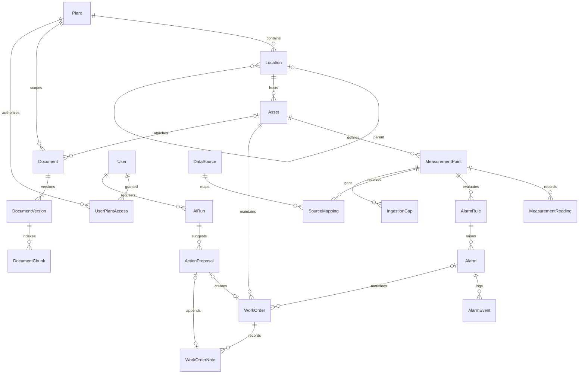

# 领域模型

本文概述业务关系与主要状态。字段、索引及约束以 [领域实体](../src/PlantOps.Domain) 和 [EF 持久化映射](../src/PlantOps.Infrastructure/Persistence) 为准。业务实体通常使用 UUID，用户沿用 Identity 的字符串 ID。业务 code 是可读标识，表之间通过实体 ID 关联。

业务结构为 `Asset → MeasurementPoint → MeasurementReading`；`SourceMapping` 将数据源连接到点位，`AlarmRule` 针对点位而非协议节点，生成 `Alarm`。**AI is not the source of truth**，不把模型输出写成测量事实或设备/告警状态。

Golden Path：North Plant → Utilities → Cooling Pump P-101 → vibration rise → alarm → acknowledge → work order → close。下面的振动点位、读数与规则在各阶段保持相同业务语义，来源可为 Simulation 或 OPC UA。

## 1. 关系

工厂内资源可冗余 PlantId 以高效授权，但必须用组合外键/应用校验保证归属一致，不能接受客户端任意提交的 PlantId。角色由 Identity 管理；UserPlantAccess 管访问范围，Document ACL 进一步缩小资料权限。

## 2. 通用约定

- 可变业务实体使用 `Version` 检查并发更新。创建、观测、处理和审计时间按各自的业务事件保留。
- UTC 时间在 PostgreSQL 用 timestamptz，API 输出带 Z；测量的源时间可能缺失，不能以接收时间冒充来源时间。
- 枚举固定字符串值，增加值必须考虑旧客户端兼容；API DTO 不直接序列化 EF 实体。
- 资产/点位/规则/用户以归档或禁用替代物理删除；工单/告警/审计历史保留。历史文档版本不可覆盖。
- 输入限制：code 1–64，name/title 1–200，描述/备注最多 8,000 字符；页面输出转义，不直接执行 Markdown 内嵌 HTML。
- 范围外关系、不同工厂的外键组合、位置循环和非法状态迁移返回明确校验错误。

## 3. 核心实体字段

### Plant

`Id, Code (全局唯一), Name, Description?, DisplayTimeZone, IsArchived, Version`。

DisplayTimeZone 仅影响显示；业务时间计算使用 UTC。归档前必须处理活跃设备和数据源，不级联删除历史。

### Location

`Id, PlantId, ParentLocationId?, Code, Name, Description?, SortOrder, IsArchived, Version`。

`(PlantId, Code)` 唯一；Parent 必须同厂，禁止自引用/祖先循环，建议深度上限 8。Asset 必须位于一个叶或非叶位置，第一版不强制叶节点；设备和位置只允许同厂迁移。

### Asset

`Id, PlantId, LocationId, Code, Name, AssetType, Manufacturer?, Model?, SerialNumber?, LifecycleStatus, Criticality, InstalledAt?, IsArchived, Version`。

`(PlantId, Code)` 唯一。LifecycleStatus = Active / OutOfService / Retired；Criticality = Low / Medium / High。运行状态来自点位，不用静态 LifecycleStatus 表示实时 Running。归档时停用点位映射，历史继续可读。

### MeasurementPoint / Signal（点位定义）

第一版采用 `MeasurementPoint` 作为实体名，Signal 仅是业务信号概念的别称，不新增一套同义表。点位描述“设备上的哪种观测”，不绑定协议、NodeId 或具体采集来源。

`Id, PlantId, AssetId, Code, Name, Quantity, CanonicalUnit, ValueType, ExpectedIntervalMs, StaleAfterMs, Enabled, Version`。

`(AssetId, Code)` 唯一；MVP ValueType = Double，Quantity 如 Vibration/Temperature/Pressure。示例点位 `VIBRATION_RMS` 单位 `mm/s`。已存在样本后，Quantity、ValueType、CanonicalUnit 不原地改，需建新点位；不同源的单位在 Adapter 转换。

存在最新快照、原始或分钟历史，或启用映射时，更改间隔、单位或量纲须建新点位。常驻 OPC UA 采集按实际订阅修正参数打开和关闭采样区间，入库复核配置版本。运行边界见 [OPC UA 集成](OPCUA_INTEGRATION.md)。

**SamplingProfile**：`Id, PointId, SourceMappingId, MappingVersion, EffectiveFrom, EffectiveTo?, Mode, RevisedSamplingIntervalMs?, RevisedPublishingIntervalMs?, RevisedQueueSize?`。Mode = Periodic / Changes / Unknown；周期覆盖率按完整且不重叠的历史生效区间及修正间隔计算，Changes、未知或缺失区间返回 null，不回填猜测的旧配置。MeasurementMinute 新增 SamplingMode，CoverageRatio 可空；原 Simulation 的固定间隔统计继续保留。协议修正参数不能由管理员请求值冒充。

### SourceMapping（数据源到点位的映射）

`Id, PlantId, DataSourceId, PointId, SourceKey, RawUnit, Scale, Offset, SourceParameters, Enabled, Version`。

SourceKey 是源内的逻辑信号键。OPC UA 的 SourceKey 由 Namespace URI 和标识符的类型、内容派生。SourceParameters 由来源类型校验，OPC UA 保存 `NamespaceUri`、`IdentifierType`、`Identifier`、`SamplingIntervalMs`、`QueueSize` 和 `SamplingMode`。两种源均使用映射的单位换算，允许的单位组合按来源类型约束。

NodeId 只在 OPC UA Adapter 内由映射参数解析；数据库保存 Namespace URI 与标识符等映射配置，不保存 SDK NodeId 对象，不向 MeasurementPoint、MeasurementReading 或 AlarmRule 暴露节点标识。

### MeasurementReading（不可变观测）

统一将原文档中的 Measurement 实体命名为 MeasurementReading；API 的 `/measurements` 资源路径保持不变。它记录某点位一次观测，不承担点位定义或数据源配置职责。

| 字段 | 语义 |
|---|---|
| Id / PlantId / AssetId / PointId | 主键与归属；由映射解析 |
| NumericValue? / CanonicalUnit | 转换后值；Bad 或转换失败可为 null |
| RawValueJson? / RawUnit? | 有长度限制的原值，便于排查，禁止无限 payload |
| SourceKind / DataSourceId / SourceMappingId / MappingVersion | Simulation 或 OpcUa 与映射追溯；两种源均需持久化映射 |
| RawStatusCode? / StatusSymbol? / Quality | 原始 uint 状态码；Quality = Good / Uncertain / Bad |
| SourceTimestamp? / ServerTimestamp? / ReceivedAt | 来源、服务器和本机接收 UTC 时间 |
| EffectiveAt / TimestampOrigin | Source 优先、Server 次之、Receive 最后；标明来源 |
| SourceEventKey / TimeAnomaly | 去重键、未来时间/异常标记 |

无效值、NaN/Infinity 不进入可信数值；保留原始状态和异常。Freshness 不存成样本 Quality，它随当前时间变化。`IsTrusted = Good && 数值有效 && 无时间异常 && 无 DataValue Overflow && 未陈旧`；规则还必须满足时间顺序与间隔要求。Good+Overflow 保留原始质量与完整状态码，登记数量未知的 ServerOverflow 可能缺口，不推进 LastGood 或待判计时，也不参与可信分钟数值统计。

按日期分区时，唯一约束至少包含分区列：`(EffectiveDate, PointId, SourceEventKey)`。重试同一 Envelope 保持 EffectiveAt/SourceEventKey 不变，避免分区间重复；已有可信源时间时重复通知产生同一键。无源/服务器时间的新通知无法可靠判定相同事件，不宣称 exactly-once。

**PointLatestState（投影）**：`PointId, LatestObservedReadingId, LastGoodReadingId?, LastReceivedAt, LastTrustedEffectiveAt?, Version`，同时复制最新观测/可信观测的值、单位、质量与时间摘要。LatestObserved 按 `(EffectiveAt, ReceivedAt)` 单调更新，不被迟到样本回退；LastReceivedAt 记录任何有效入站通知。未来时间异常样本只进历史异常记录，不成为“最新”值。LastGood 保留历史可信观测，但其新鲜度独立计算，不可一直显示为当前正常。

**MeasurementMinute（投影）** 包含 `PointId`、`BucketStart`、有效 Good 数值的最小值、最大值、平均值，以及按质量统计的样本数、采样模式、缺口和覆盖率，唯一键为 `(PointId, BucketStart)`。覆盖率依据适用的期望间隔和已知区间计算，最高为 1。变化通知、未知或不适用的区间没有覆盖率。

### Alarm（业务告警实例）

`Id, PlantId, AssetId, PointId, RuleId, RuleVersion, Severity, State, TriggerReadingId, TriggerValue, ThresholdSnapshot, StartedAt, RecoveredAt?, AcknowledgedAt?, AcknowledgedByUserId?, LastEvaluatedAt, Version`。

State = Active / Recovered；Acknowledged 是独立维度，由时间/用户表达。唯一部分索引约束每 RuleId 只有一个 Active。告警实例保存规则阈值快照，之后改规则不能重写历史。

### WorkOrder

`Id, PlantId, AssetId, AlarmId?, Number, Title, Description, Priority, Status, AssignedToUserId?, CreatedByUserId, CompletedAt?, ClosedAt?, Resolution?, Source, AiProposalId?, Version`。

Number 在工厂内唯一；AlarmId 必须同设备同工厂；AssignedTo 必须有该厂维护权限。Source = Manual / AiApproved；AiProposalId 在创建工单动作时唯一。

状态：Draft → Open → InProgress → Completed → Closed。Draft/Open/InProgress 可 Cancelled，Completed 可退回 InProgress（记录原因），Closed/Cancelled 终态。完成需 Resolution；关闭需 Completed 和关闭者权限。工单关闭不修改 Alarm.State。

维修历史是资产的 Completed/Closed 工单及其备注投影，第一版不再维护一套易失同步的 MaintenanceHistory 表。

`WorkOrderNote` 保留 `WorkOrderId`、内容、类别、提交者和发生时间。由审批提案追加的备注带 `AiProposalId`。备注和状态变更与工单版本、审计在同一事务保存。关闭或取消后禁止追加，返工原因与旧结果由备注及审计回查。写操作要求同厂 MaintenanceEngineer 或 Admin 权限，指派仅允许启用且有同厂维护权限的用户。

### Document / DocumentVersion

Document：`Id, PlantId, AssetId?, Title, Category, Visibility, AllowedRoles[], CurrentPublishedVersionId?, IsArchived, Version`。Visibility = PlantReaders / RestrictedRoles；角色列表仅限制读取，工厂授权始终必需。

DocumentVersion：`Id, DocumentId, VersionNumber, FileName, MediaType, StorageKey, Sha256, SizeBytes, Status, UploadedByUserId, UploadedAt, PublishedAt?, IndexStatus, ParserVersion?`。

版本状态为 Draft、Published 或 Withdrawn。发布事务更新当前发布版本，调查检索仅使用当前发布并获授权的版本。查询和展开引用时重新校验版本、文件及访问权限。历史引用同样受当前 ACL、发布和撤回状态约束。

读取文档元数据要求同厂与 ACL，普通读者仅可见可发布读取的资料和 Published 版本，维护角色可查看其授权范围内草稿。每份资料最多 200 个内容版本，版本号不可变，文件以 SHA-256 追溯。TXT/MD 可生成 `Ready` 文本片段，过大或无效文本等情况保留相应索引状态。PDF 保留原文件，索引状态为 `NeedsText`。PDF 页码索引和检索增强见 [开发计划 P7](../ROADMAP.md#5-p7设备知识与-rag-增强)。

### User

本地账号使用 `PlantOpsUser` 的 `Id`、`UserName`、`DisplayName`、`IsEnabled` 和 `SecurityStamp`。角色与密码哈希由 ASP.NET Core Identity 管理。

`UserPlantAccess` 使用 `UserId` 和 `PlantId` 的组合键，并保留授权时间及授权者。请求、实时连接和审批执行都会重新核对当前授权。

位置父节点和设备位置以复合外键强制同厂。事务中检查位置自引用与祖先循环。归档工厂要求先处理未归档设备及启用的数据源，归档位置要求先处理其未归档的子位置和设备。归档后的历史仍受工厂授权约束。

## 4. 告警规则与状态语义

AlarmRule：`Id, PlantId, PointId, Name, RuleType=HighThreshold, RaiseAbove, ClearBelow, RaiseForMs, ClearForMs, MaxSampleGapMs, Severity, Enabled, Version`。要求 `ClearBelow < RaiseAbove`，全部阈值使用点位标准单位。

演示规则：RaiseAbove = 10.0 mm/s，ClearBelow = 8.0 mm/s；连续 3 秒高值触发，连续 5 秒低值恢复；点位期望 1 Hz，MaxSampleGapMs = 2,500。数字是虚构演示配置。

1. Good、新鲜、时间有效且按序的值 `> RaiseAbove` 开始 PendingRaise；持续高值且采样间隔不超限满 3 秒 → 创建 Active。
2. 低于或等于 RaiseAbove 中断 PendingRaise；Bad/Uncertain/陈旧/采样缺口重置待触发计时，不产生阈值结论。
3. Active 时值 `< ClearBelow` 开始 PendingClear；连续满 5 秒 → Recovered。区间 `[ClearBelow, RaiseAbove]` 保持 Active，重置待恢复计时。
4. Bad/Uncertain/陈旧/断线只中断计时，既有 Active 保持；UI 显示“当前状态无法验证”。迟到样本只归档，不重演在线状态机。
5. 确认可在 Active/Recovered 上执行，重复确认幂等返回当前状态，不覆盖原确认者。
6. 改规则/停用规则时清除待触发/恢复计时；若存在 Active，拒绝配置修改，要求先明确处理。数据源断线不是规则恢复的理由。
7. 规则运行状态 `PendingRaiseSince?, PendingClearSince?, LastTrustedAt?` 持久化；进程重启后计时清零，已有 Active 保留，避免跨未知间隙延续计时。

AlarmEvent：`Id, AlarmId, EventType (Raised/Acknowledged/Recovered), OccurredAt, ActorUserId?, ReadingId?, CorrelationId`，不可变；与告警更新同事务。

## 5. 集成与 AI 辅助实体

| 实体 | 关键字段 / 约束 |
|---|---|
| DataSource | Id、PlantId、Name、Kind (Simulation/OpcUa)、ConnectionParameters、Enabled、Version。OPC UA 的配置保存 EndpointReference 与 PublishingIntervalMs，受控回环启用要求见 [OPC UA 集成](OPCUA_INTEGRATION.md) |
| IngestionGap | Id、PointId、DataSourceId?、From、To?、Reason、DetectedAt、RecoveredAt?、DroppedCount?、IsPossible；未知数量为 null，缺口不等同实际每个样本都已丢失 |
| DocumentChunk | Id、DocumentId、VersionId、Ordinal、Section、StartLine、EndLine、Text、Sha256、ParserVersion |
| AiRun | 保存工厂、设备、告警、发起者、调查语言、Provider/Model、执行状态、冻结证据和结果。`RunRecordJson` 保留新运行的版本指纹、用量及诊断 |
| ActionProposal | 关联调查、工厂、设备和告警，保存所有者、动作类型、正文与哈希、依赖资源版本、版本及截止时间。执行后记录结果实体和执行时间 |
| AuditLog | Id、ActorUserId?/ServiceActor、Action、ResourceType/Id、PlantId、Before/After 摘要、OccurredAt、CorrelationId、AiRunId?/ProposalId? |

同点位最多一个 Enabled 的主映射；SourceMapping 与 DataSource/Point 必须同厂。Simulation Source 与 OPC UA Source 均保留，可在不同点位同时运行，也可通过独立演示配置分别跑通 Golden Path。同点位改来源必须显式停用旧映射、排空/隔离旧队列、启用新映射并中断规则待判计时，保留来源切换记录及可能缺口；不自动回退到模拟源，不混合两种源的读数。

`ActionProposal` 从 Pending 转为 Rejected、Expired、Invalidated 或 Executed。人工确认后，提案状态和业务写入在同一事务完成。提交结果未知时，先按提案 Id 查回执。创建工单写入关联告警的 Draft，追加备注写入目标工单。

服务端检查调查哈希与资料权限，并通过 `AssetVersion`、`AlarmVersion` 和备注动作的 `TargetWorkOrderVersion` 核对目标当前版本。

## 6. 一致性与查询

点位、映射及读数使用同厂复合外键，启用映射使用 `PointId` 的部分唯一索引。点位的标准间隔为 1–60 整秒，陈旧阈值覆盖间隔且不超过 300 秒。来源配置通过受校验的输入模型写入。

入库验证当前配置版本及启用状态，跨厂或旧配置样本整批拒绝；未来有效时间超过接收时间 5 秒标记 TimeAnomaly 并仅入历史。乱序照常存历史；LatestObserved 按时间元组单调更新；LastGood 只接受接收时新鲜的有效 Good。LastReceivedAt 可由去重通知更新，不能据此把旧有效时间视为新鲜。NaN/Infinity/转换溢出标准化为 Bad/null 并保留有长度限制的原值 JSON。

读数按 `EffectiveDate` 的 UTC 日期分区。`DirtyMeasurementMinute` 标记包含迟到或新数据的待重算分钟。`MeasurementPartition` 保存原始分区和聚合的修订版本，保留任务同时核对原始与聚合样本数量。采集间断保存在 `IngestionGap`。设备归档同事务停用点位与映射、递增版本并分别审计。

- 工厂范围在所有读取、写入、检索和实时推送统一强制；不能只过滤列表而漏掉按 ID 查询。
- 资产位置修改、工单迁移、审批执行均带 version；直接覆盖更新不允许。
- 测量是历史事实；最新快照/聚合是可重建投影。Outbox 与审计不可代替测量历史。
- 常用索引：Asset `(PlantId, LocationId)`，Alarm `(PlantId, State, StartedAt)`，WorkOrder `(AssetId, Status)`，Document `(PlantId, AssetId)`；具体索引使用查询计划验证。
- 历史原始测量过期后，告警保留 TriggerValue/阈值快照，UI 引用明确显示“原始样本已过保留期”，不能提供失效证据链接冒充仍可用。
- 测量引用必须适配分区清理：Alarm/AlarmEvent 与最新投影中的 ReadingId 是可失效的追溯标识，保留必要值/质量/时间快照，不建立会阻止删除分区的强外键，也不级联删除业务记录。AiRun 的测量证据同样保存带保留期说明的摘要，原始数据过期后仅显示该摘要及其取数时刻。

P1.4 已迁移 AlarmRule/RuleRuntimeState/Alarm/AlarmEvent：规则和告警以复合外键校验工厂、点位、设备；Severity 固定 Low/Medium/High。每点位最多 20 条规则，持续 0–300000ms，最大间隔不小于点位期望间隔且不超过 300000ms。Runtime 保存顺序水位、最后可信观测及配置版本；未来异常、质量不可信、陈旧和过长间隔清空待判计时，迟到不重演。确认允许 Active/Recovered，首次检查 version；重复确认不覆盖首次人和时间。Active 阻止规则变更和设备归档，恢复历史允许归档但不删除。事件与业务审计同事务，服务 actor 为 worker:alarm-engine；规则阈值快照不随后续配置修改。
