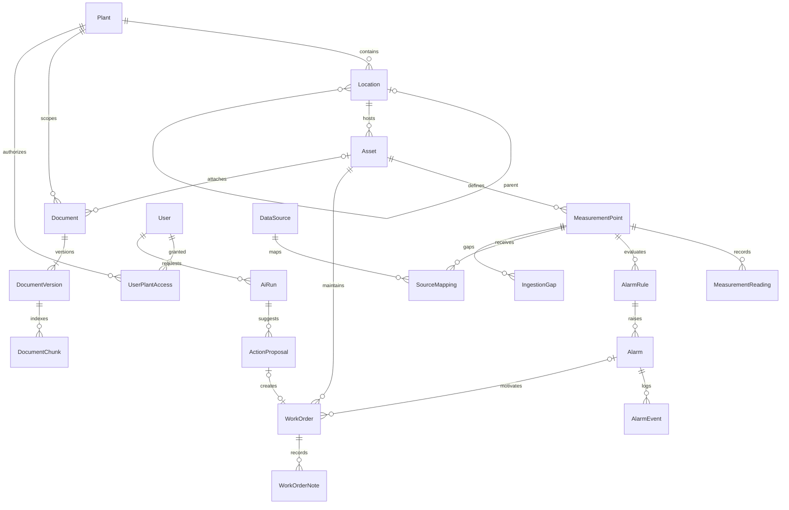

# 领域模型 v0.1

日期：2026-10-03。本文件是字段与状态语义的权威来源。采用关系模型，实体 ID 默认 UUID；业务 code 是可读标识，不作为跨表外键。

业务结构为 `Asset → MeasurementPoint → MeasurementReading`；`SourceMapping` 将数据源连接到点位，`AlarmRule` 针对点位而非协议节点，生成 `Alarm`。**AI is not the source of truth**，不把模型输出写成测量事实或设备/告警状态。

Golden Path：North Plant → Utilities → Cooling Pump P-101 → vibration rise → alarm → acknowledge → work order → close。下面的振动点位、读数与规则在各阶段保持相同业务语义，来源可为 Simulation 或 OPC UA。

## 1. 关系

工厂内资源可冗余 PlantId 以高效授权，但必须用组合外键/应用校验保证归属一致，不能接受客户端任意提交的 PlantId。角色由 Identity 管理；UserPlantAccess 管访问范围，Document ACL 进一步缩小资料权限。

## 2. 通用约定

- 可变业务实体：Id、CreatedAt、UpdatedAt、Version（bigint，应用更新时加 1，EF 并发 token）。不可变样本/日志使用 Id 和 CreatedAt，不伪造 UpdatedAt。
- UTC 时间在 PostgreSQL 用 timestamptz，API 输出带 Z；测量的源时间可能缺失，不能以接收时间冒充来源时间。
- 枚举固定字符串值，增加值必须考虑旧客户端兼容；API DTO 不直接序列化 EF 实体。
- 资产/点位/规则/用户以归档或禁用替代物理删除；工单/告警/审计历史保留。历史文档版本不可覆盖。
- 输入限制：code 1–64，name/title 1–200，描述/备注最多 8,000 字符；页面输出转义，不直接执行 Markdown 内嵌 HTML。
- 范围外关系、不同工厂的外键组合、位置循环和非法状态迁移返回明确校验错误。

## 3. 核心实体字段

### Plant

`Id, Code (全局唯一), Name, Description?, DisplayTimeZone, IsArchived, Version`。

DisplayTimeZone 仅影响显示；业务时间计算使用 UTC。归档前必须处理活跃设备和数据源，不级联删除历史。

### Location

`Id, PlantId, ParentLocationId?, Code, Name, Description?, SortOrder, IsArchived, Version`。

`(PlantId, Code)` 唯一；Parent 必须同厂，禁止自引用/祖先循环，建议深度上限 8。Asset 必须位于一个叶或非叶位置，第一版不强制叶节点；设备和位置只允许同厂迁移。

### Asset

`Id, PlantId, LocationId, Code, Name, AssetType, Manufacturer?, Model?, SerialNumber?, LifecycleStatus, Criticality, InstalledAt?, IsArchived, Version`。

`(PlantId, Code)` 唯一。LifecycleStatus = Active / OutOfService / Retired；Criticality = Low / Medium / High。运行状态来自点位，不用静态 LifecycleStatus 表示实时 Running。归档时停用点位映射，历史继续可读。

### MeasurementPoint / Signal（点位定义）

第一版采用 `MeasurementPoint` 作为实体名，Signal 仅是业务信号概念的别称，不新增一套同义表。点位描述“设备上的哪种观测”，不绑定协议、NodeId 或具体采集来源。

`Id, PlantId, AssetId, Code, Name, Quantity, CanonicalUnit, ValueType, ExpectedIntervalMs, StaleAfterMs, Enabled, Version`。

`(AssetId, Code)` 唯一；MVP ValueType = Double，Quantity 如 Vibration/Temperature/Pressure。示例点位 `VIBRATION_RMS` 单位 `mm/s`。已存在样本后，Quantity、ValueType、CanonicalUnit 不原地改，需建新点位；不同源的单位在 Adapter 转换。

### SourceMapping（数据源到点位的映射）

`Id, PlantId, DataSourceId, PointId, SourceKey, RawUnit, Scale, Offset, SourceParameters, Enabled, Version`。

SourceKey 是源内的逻辑信号键，例如模拟器的 `P101.VibrationRms`；SourceParameters 是经来源类型 schema 校验、版本化的配置：Simulation 保存场景/信号参数，OPC UA 保存 NamespaceUri、IdentifierType、Identifier、SamplingIntervalMs、QueueSize。单位转换规则对两种源统一适用。

NodeId 只在 OPC UA Adapter 内由映射参数解析；数据库保存 Namespace URI 与标识符等映射配置，不保存 SDK NodeId 对象，不向 MeasurementPoint、MeasurementReading 或 AlarmRule 暴露节点标识。

### MeasurementReading（不可变观测）

统一将原文档中的 Measurement 实体命名为 MeasurementReading；API 的 `/measurements` 资源路径保持不变。它记录某点位一次观测，不承担点位定义或数据源配置职责。

| 字段 | 语义 |
|---|---|
| Id / PlantId / AssetId / PointId | 主键与归属；由映射解析 |
| NumericValue? / CanonicalUnit | 转换后值；Bad 或转换失败可为 null |
| RawValueJson? / RawUnit? | 有长度限制的原值，便于排查，禁止无限 payload |
| SourceKind / DataSourceId / SourceMappingId / MappingVersion | Simulation 或 OpcUa 与映射追溯；两种源均需持久化映射 |
| RawStatusCode? / StatusSymbol? / Quality | 原始 uint 状态码；Quality = Good / Uncertain / Bad |
| SourceTimestamp? / ServerTimestamp? / ReceivedAt | 来源、服务器和本机接收 UTC 时间 |
| EffectiveAt / TimestampOrigin | Source 优先、Server 次之、Receive 最后；标明来源 |
| SourceEventKey / TimeAnomaly | 去重键、未来时间/异常标记 |

无效值、NaN/Infinity 不进入可信数值；保留原始状态和异常。Freshness 不存成样本 Quality，它随当前时间变化。`IsTrusted = Good && 数值有效 && 无时间异常 && 未陈旧`；规则还必须满足时间顺序与间隔要求。

按日期分区时，唯一约束至少包含分区列：`(EffectiveDate, PointId, SourceEventKey)`。重试同一 Envelope 保持 EffectiveAt/SourceEventKey 不变，避免分区间重复；已有可信源时间时重复通知产生同一键。无源/服务器时间的新通知无法可靠判定相同事件，不宣称 exactly-once。

**PointLatestState（投影）**：`PointId, LatestObservedReadingId, LastGoodReadingId?, LastReceivedAt, LastTrustedEffectiveAt?, Version`，同时复制最新观测/可信观测的值、单位、质量与时间摘要。LatestObserved 按 `(EffectiveAt, ReceivedAt)` 单调更新，不被迟到样本回退；LastReceivedAt 记录任何有效入站通知。未来时间异常样本只进历史异常记录，不成为“最新”值。LastGood 保留历史可信观测，但其新鲜度独立计算，不可一直显示为当前正常。

**MeasurementMinute（投影）**：`PointId, BucketStart, Min?, Max?, Avg?, GoodCount, UncertainCount, BadCount, HasGap, CoverageRatio`，唯一 `(PointId, BucketStart)`；统计 Good 且无时间异常的数值。CoverageRatio 是实际有效样本数/按订阅修正采样间隔预期数，最高 1；变化通知模式下不使用该比率推断物理采样覆盖。

### Alarm（业务告警实例）

`Id, PlantId, AssetId, PointId, RuleId, RuleVersion, Severity, State, TriggerReadingId, TriggerValue, ThresholdSnapshot, StartedAt, RecoveredAt?, AcknowledgedAt?, AcknowledgedByUserId?, LastEvaluatedAt, Version`。

State = Active / Recovered；Acknowledged 是独立维度，由时间/用户表达。唯一部分索引约束每 RuleId 只有一个 Active。告警实例保存规则阈值快照，之后改规则不能重写历史。

### WorkOrder

`Id, PlantId, AssetId, AlarmId?, Number, Title, Description, Priority, Status, AssignedToUserId?, CreatedByUserId, CompletedAt?, ClosedAt?, Resolution?, Source, AiProposalId?, Version`。

Number 在工厂内唯一；AlarmId 必须同设备同工厂；AssignedTo 必须有该厂维护权限。Source = Manual / AiApproved；AiProposalId 在创建工单动作时唯一。

状态：Draft → Open → InProgress → Completed → Closed。Draft/Open/InProgress 可 Cancelled，Completed 可退回 InProgress（记录原因），Closed/Cancelled 终态。完成需 Resolution；关闭需 Completed 和关闭者权限。工单关闭不修改 Alarm.State。

维修历史是资产的 Completed/Closed 工单及其备注投影，第一版不再维护一套易失同步的 MaintenanceHistory 表。

### Document / DocumentVersion

Document：`Id, PlantId, AssetId?, Title, Category, Visibility, AllowedRoles[], CurrentPublishedVersionId?, IsArchived, Version`。Visibility = PlantReaders / RestrictedRoles；角色列表仅限制读取，工厂授权始终必需。

DocumentVersion：`Id, DocumentId, VersionNumber, FileName, MediaType, StorageKey, Sha256, SizeBytes, Status, UploadedByUserId, UploadedAt, PublishedAt?, IndexStatus, ParserVersion?`。

Status = Draft / Published / Withdrawn；IndexStatus = NotRequested / Pending / Processing / Ready / NeedsText / Failed。发布事务更新当前发布版本，旧版本内容保留但默认 RAG 只检索当前版本。撤回、ACL 更改和归档立即阻止检索/下载；后台删除向量可延迟，但查询必须实时校验源文档状态。历史引用受当前权限约束，不能借旧链接绕过撤回。

### User

`Id, IdentitySubject, DisplayName, IsEnabled, Roles, SecurityStamp`；密码哈希等由 Identity 管理，不在 API DTO 暴露。

UserPlantAccess：`UserId, PlantId, GrantedAt, GrantedByUserId`，组合唯一。禁用/撤权更新会话安全状态、关闭实时连接并使待执行提案重新校验失败。

P1.2 已实现 ASP.NET Core Identity 的 PlantOpsUser（Id/UserName/DisplayName/IsEnabled/SecurityStamp）、Identity 角色表与上述 UserPlantAccess。IdentitySubject 留给外部身份映射，当前本地账号以 Identity Id 为用户标识；无实时连接或动作提案。Plant/Location/Asset 上述字段已迁移。位置父节点和设备位置以复合外键强制同厂，删除关系 Restrict；位置自引用/循环由事务用例验证。归档不删除任何行，当前不支持恢复；归档工厂拒绝未归档设备，归档位置拒绝未归档子位置/设备。AuditLog 持久化 actor、工厂、资源、before/after、UTC 时间与 correlationId；历史摘要不依赖可删除的当前实体外键。

## 4. 告警规则与状态语义

AlarmRule：`Id, PlantId, PointId, Name, RuleType=HighThreshold, RaiseAbove, ClearBelow, RaiseForMs, ClearForMs, MaxSampleGapMs, Severity, Enabled, Version`。要求 `ClearBelow < RaiseAbove`，全部阈值使用点位标准单位。

演示规则：RaiseAbove = 10.0 mm/s，ClearBelow = 8.0 mm/s；连续 3 秒高值触发，连续 5 秒低值恢复；点位期望 1 Hz，MaxSampleGapMs = 2,500。数字是虚构演示配置。

1. Good、新鲜、时间有效且按序的值 `> RaiseAbove` 开始 PendingRaise；持续高值且采样间隔不超限满 3 秒 → 创建 Active。
2. 低于或等于 RaiseAbove 中断 PendingRaise；Bad/Uncertain/陈旧/采样缺口重置待触发计时，不产生阈值结论。
3. Active 时值 `< ClearBelow` 开始 PendingClear；连续满 5 秒 → Recovered。区间 `[ClearBelow, RaiseAbove]` 保持 Active，重置待恢复计时。
4. Bad/Uncertain/陈旧/断线只中断计时，既有 Active 保持；UI 显示“当前状态无法验证”。迟到样本只归档，不重演在线状态机。
5. 确认可在 Active/Recovered 上执行，重复确认幂等返回当前状态，不覆盖原确认者。
6. 改规则/停用规则时清除待触发/恢复计时；若存在 Active，拒绝配置修改，要求先明确处理。数据源断线不是规则恢复的理由。
7. 规则运行状态 `PendingRaiseSince?, PendingClearSince?, LastTrustedAt?` 持久化；进程重启后计时清零，已有 Active 保留，避免跨未知间隙延续计时。

AlarmEvent：`Id, AlarmId, EventType (Raised/Acknowledged/Recovered), OccurredAt, ActorUserId?, ReadingId?, CorrelationId`，不可变；与告警更新同事务。

## 5. 集成与 AI 辅助实体

| 实体 | 关键字段 / 约束 |
|---|---|
| DataSource | Id、PlantId、Name、Kind (Simulation/OpcUa)、ConnectionParameters、CredentialRef?、Enabled、Version；OPC UA 的 EndpointUrl/SecurityPolicy/MessageSecurityMode 属于经类型校验的连接配置，Simulation 无需这些参数；凭据只保存引用 |
| SourceMapping | 见核心实体定义；统一映射字段与按来源类型校验的参数分离，Phase 1 已用于 Simulation，Phase 2 新增 OPC UA 配置 |
| IngestionGap | Id、PointId、DataSourceId?、From、To?、Reason、DetectedAt、RecoveredAt?；缺口不等同实际每个样本都已丢失 |
| DocumentChunk | Id、DocumentVersionId、Ordinal、Page?、Section?、Text、ContentHash、EmbeddingModelId、Embedding；内容与版本不可变 |
| AiRun | Id、RequestedByUserId、PlantId、AlarmId、Status、PromptVersion、SchemaVersion、Provider/Model、StartedAt、CompletedAt?、Usage、ErrorCode、CorrelationId、ResultJson? |
| ActionProposal | Id、AiRunId、RequestedByUserId、ActionType、TargetId、PayloadJson、PayloadHash、TargetVersionsJson、Status、ExpiresAt、ApprovedBy?、ApprovedAt?、ResultEntityId?、Version |
| AuditLog | Id、ActorUserId?/ServiceActor、Action、ResourceType/Id、PlantId、Before/After 摘要、OccurredAt、CorrelationId、AiRunId?/ProposalId? |

同点位最多一个 Enabled 的主映射；SourceMapping 与 DataSource/Point 必须同厂。Simulation Source 与 OPC UA Source 均保留，可在不同点位同时运行，也可通过独立演示配置分别跑通 Golden Path。同点位改来源必须显式停用旧映射、排空/隔离旧队列、启用新映射并中断规则待判计时，保留来源切换记录及可能缺口；不自动回退到模拟源，不混合两种源的读数。

ActionProposal 状态：Pending → Rejected / Expired / Executed / Failed。第一版批准和执行在一个数据库事务中完成，成功原子变为 Executed；不设置“已批准但尚未执行”的隐式窗口。Failed 只表示确知未产生业务效果的校验/执行失败；提交结果未知时先按 Id 查询，不直接重复创建。

TargetVersionsJson 保存所有动作依赖的资源版本：创建工单至少 Asset 与所关联 Alarm；追加备注至少 WorkOrder 与 Asset。服务端构造此快照，模型不能决定应校验哪些资源。

## 6. 一致性与查询

P1.3 已实现 MeasurementPoint/DataSource/SourceMapping/MeasurementReading/PointLatestState。点位、映射及读数使用同厂复合外键；启用映射使用 PointId 的部分唯一索引。点位定义默认 Double，来源配置当前固定 schemaVersion=1 的 Simulation/GoldenPath；标准间隔为 1–60 整秒、陈旧阈值覆盖间隔且不超过 300 秒。不开放任意 JSON/协议配置写入。

入库验证当前配置版本及启用状态，跨厂或旧配置样本整批拒绝；未来有效时间超过接收时间 5 秒标记 TimeAnomaly 并仅入历史。乱序照常存历史；LatestObserved 按时间元组单调更新；LastGood 只接受接收时新鲜的有效 Good。LastReceivedAt 可由去重通知更新，不能据此把旧有效时间视为新鲜。NaN/Infinity/转换溢出标准化为 Bad/null 并保留有长度限制的原值 JSON。

本阶段尚未分区，读数去重约束为 `(PointId, SourceEventKey)`；未来分区列调整需迁移此约束。MeasurementMinute 仍为目标设计，目前返回按需统计，不保存分钟投影。P1.3 不实现告警/规则/Outbox/IngestionGap 实体；缺口由查询中的期望间隔和时间边界推导。设备归档同事务停用点位与映射、递增版本并分别审计，历史可在原授权范围内查询。

- 工厂范围在所有读取、写入、检索和实时推送统一强制；不能只过滤列表而漏掉按 ID 查询。
- 资产位置修改、工单迁移、审批执行均带 version；直接覆盖更新不允许。
- 测量是历史事实；最新快照/聚合是可重建投影。Outbox 与审计不可代替测量历史。
- 常用索引：Asset `(PlantId, LocationId)`，Alarm `(PlantId, State, StartedAt)`，WorkOrder `(AssetId, Status)`，Document `(PlantId, AssetId)`；具体索引使用查询计划验证。
- 历史原始测量过期后，告警保留 TriggerValue/阈值快照，UI 引用明确显示“原始样本已过保留期”，不能提供失效证据链接冒充仍可用。
- 测量引用必须适配分区清理：Alarm/AlarmEvent 与最新投影中的 ReadingId 是可失效的追溯标识，保留必要值/质量/时间快照，不建立会阻止删除分区的强外键，也不级联删除业务记录。AiRun 的测量证据同样保存带保留期说明的摘要，原始数据过期后仅显示该摘要及其取数时刻。
