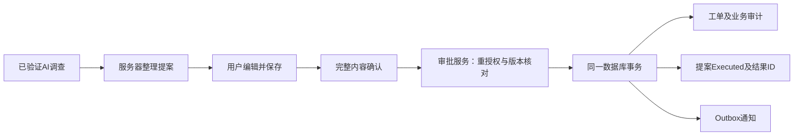

# P4人工审批：首个创建工单增量设计

日期：2026-10-13。状态：可审阅设计，未实现/未验收。用户已选择“复用已通过的AI调查内容整理草稿，不新增模型调用”。首个增量建议完成创建工单；追加备注沿用同一审批机制，在后续增量独立验收。本文件细化AI_DESIGN第6节，不代表完整P3或P4通过。

## 目标和当前证据

演示路径：告警调查成功 → 查看事实/警告/引用 → 点击整理工单草稿 → 编辑并保存 → 核对完整内容 → 明确确认创建 → 查看唯一工单与审批记录。

五个固定真实样本已取得有效答案，有限语义复核通过；原自动检查4通过、1次关键词检查失败原样保留并另附复核。它们只足以支持讨论有限P4演示，完整20真实场景、广泛抗注入及长期稳定性/成本仍未验收。

现有实现核对：

- `InvestigationService`已按发起人隔离AiRun、重新检查工厂/设备权限和文档证据；撤权/换版可隐藏原答案。
- `WorkOrderService.CreateAsync/NoteAsync`已重新检查用户启用状态、Admin/MaintenanceEngineer角色、工厂范围，使用工厂事务锁、版本检查和事务审计。
- `CreateAsync/NoteAsync`各自开启并提交事务，目前不能直接放进提案执行事务。`NoteAsync`只返回WorkOrder，后续备注执行还需在内部获取唯一Note ID。
- WorkOrder已预留`Source`和`AiProposalId`字段，`MaintenanceModel`及维护迁移已包含AiProposalId唯一索引，可作为单提案单工单的基础；尚无提案实体/外键和执行流程，不能仅凭此索引宣称完整幂等。
- API已有会话和防伪中间件；告警调查入口及手工工单入口保持独立。

## 用户流程与草稿内容

只有本次成功调查的发起用户，且当前具备Admin/MaintenanceEngineer和工厂权限，才可生成、编辑、拒绝及确认自己的提案。Viewer/Operator继续只读，不能借提案升级为维护写权限。首版不引入他人审批队列或双人审批。

“整理工单草稿”明确说明：基于已验证AI调查的模板整理，不会再调用模型。此操作只保存提案与提案审计，不创建工单。目标工厂/设备/告警由AiRun固定，不能由模型或客户端替换；未成功、失效或不可授权读取的调查不生成提案。

草稿内容：标题使用固定的检查任务表达；描述分别整理观测、待验证假设、建议检查、缺失信息及服务端质量警告，保留引用ID和来源标识。不得把weak假设改写为确诊原因，也不得把Simulation标记改成现场观测。标题200字符、描述8000字符，超过限制明确提示缩减，不静默截掉警告或引用。默认优先级Medium标为模板默认；用户可选Low/Medium/High。责任人由用户选择，也可明确选择暂不分配，不从模型建议推断人员。

用户编辑后点击保存，再展示新的完整确认页面。确认按钮命名“确认创建工单”，显示目标、标题、全部描述、优先级、责任人、关联告警、警告和可展开证据；不把“查看/复制/保存草稿”当作批准。提案15分钟到期，以服务端时钟为准；编辑增加版本及hash，不延长原到期时刻，过期后需重新生成并复核上下文。

创建后工单仍为已有`Draft`状态，后续打开、执行、关闭沿用手工业务状态机。界面分别说明“待审批提案”和“已创建的Draft工单”，避免两种草稿混淆。重复点击整理时可有意生成新提案，但Pending页优先展示已有提案；同一Proposal的幂等不等于禁止人手有意重复创建不同工单。

## 架构与事务边界

审批端点同步执行短事务，不经过AiRun Worker，不在事务内调用模型或外部服务。服务器锁定提案，检查内容未变、未过期且仍可执行，再通过同一业务命令核心创建工单。工单、业务审计、Outbox和提案Executed/ResultEntityId同事务成功或回滚。通知由既有Outbox分发，推送失败不能让工单重建。

需先重构工单命令的内部事务组合方式：公开手工入口继续自己管理事务；内部命令核心复用同一scoped DbContext与调用方事务，不自行提交。内部接口只在Infrastructure中使用，不向模型或客户端开放绕过授权、工厂锁或审计的入口。避免用“先调现有CreateAsync，再保存提案”造成两次提交。

锁顺序建议统一为工厂事务锁 → 提案行 → 相关资源行，所有审批/编辑/拒绝遵守一致顺序。现有工厂锁不能单独证明权限及文档并发安全；实现时还需锁住参与判定的用户/授权成员行、设备/告警和文档元数据，或采用等价的可验证并发控制，保证重新检查与提交之间不被撤权/换版穿过。仅“查一次版本再写入”不算完成。并发撤权/归档/文档撤回测试是实现门槛，锁协议细节在实现前结合各写入口核实。

创建时冻结设备和关联告警版本，不对持续变化的LatestReading加审批版本锁；当前观测质量仍显示为警告，不能依据批准推断设备安全。告警确认/恢复或设备变更使Pending提案失效，需要刷新上下文、重新生成/确认；不能静默替换已确认内容。证据授权沿用调查当前语义，不把原读取权限永久缓存。

## 提案记录、状态和接口草案

ActionProposal至少保存：Id、schemaVersion、AiRunId、PlantId/AssetId/AlarmId、OwnerUserId、ActionType、DraftOrigin、PayloadJson、PayloadHash、Version、资源版本快照、证据ID/版本/hash、CreatedAt/ExpiresAt、Status、ResultEntityId、ExecutedAt及审批CorrelationId。`DraftOrigin=InvestigationTemplate`，不能把旧AiRun默认PromptVersion当作真实提示版本证明。

首版ActionType仅CreateWorkOrder；后续才启用AppendWorkOrderNote。Pending可编辑、拒绝、过期、失效或执行。Executed/Rejected/Expired/Invalidated均不可再执行；已执行记录是权威凭证。没有独立持久化Approved状态：人工批准与业务执行在一次短事务里完成。执行异常回滚后不得残留“已批准但没工单”；无法确定提交结果时先查询原提案，不创建第二个提案代替。

PayloadHash由服务器对规范化后的最终字段、目标/动作和人工选择计算SHA256。先做与业务写入相同的trim/默认值处理，拒绝未知字段，再hash；不对任意客户端JSON字节直接hash。Version作为乐观并发标记。数据库防止同一Proposal对应多个工单时复用现有WorkOrder.AiProposalId唯一索引，再补提案引用及同厂设备约束；不重复建立同一索引，不依赖按钮禁用或模型遵守。

| 候选接口 | 行为 |
|---|---|
| POST `/investigations/{id}/proposals` | 明确整理点击；重新授权；固定CreateWorkOrder；保存Pending提案，不写工单 |
| GET `/action-proposals/{id}` | 发起人/当前范围授权；返回当前完整提案、失效原因或最小执行凭证 |
| PATCH `/action-proposals/{id}` | 仅Pending，提交期望版本，保存允许编辑字段；服务器增加版本/hash |
| POST `/action-proposals/{id}/reject` | 核对发起人和期望版本，事务内记录Rejected，无工单写入 |
| POST `/action-proposals/{id}/execute` | 提交期望版本/hash及Idempotency-Key，重授权后同事务执行 |

接口均在已有`/api/v1`会话/防伪框架下。执行请求不接受新的业务payload、角色、actor或目标ID，只确认服务器已保存的内容。客户端超时/断线时显示“结果待核实”，GET原Proposal；需要重发则使用同一Proposal/版本/hash/key。

服务器执行顺序：验证会话/角色/归属 → 加锁重读 → 验证idempotency请求绑定 → 对已Executed且请求匹配的调用返回原结果 → 核对Pending/期限/版本/hash → 重新授权证据/目标/责任人 → 执行业务命令 → 写提案结果/审计 → 提交。相同key不同内容或旧hash不能取得一次新执行；不同key针对已执行的同一版本只能得到同一原结果，不再写入。key绑定不宜单独在事务外持久化“已消费”状态，避免事务回滚后错误阻止恢复。

执行后查看最小凭证仍要求当前用户/工厂/设备权限；文档撤权后不得从完整提案或旧证据回显原内容。已创建工单按既有工单读取权限访问，提案凭证不会给他人附加权限。

## 决策记录（拟议）

### ADR-P4-01：复用调查整理草稿

已由用户选择：使用已验证调查模板整理，成本可控、无需新增供应商失败路径；代价是草稿不如专门生成灵活，需要人工编辑。另一方案是独立模型调用生成typed草稿，仍必须后校验，但增加预算/重试/质量验收；第三方案是扩展P3调查输出同时生成动作草稿，会耦合已验收的只读契约和P4，首版不采用。每种方案都必须人工确认，不能让模型调用写工具。

### ADR-P4-02：首个增量只创建工单

建议先完整打通创建工单的确认、幂等和恢复，再接追加备注；代价是首个增量不算完整P4两类动作交付。一起实现两类动作可少一次UI扩展，但会叠加工单版本、终态及Note ID幂等问题。首版不以裁剪安全控制来换两类动作同时上线。

### ADR-P4-03：复用单库事务与业务命令核心

建议在现有模块化单体、EF Core/PostgreSQL内完成执行，兼容既有工厂锁、审计及Outbox。代价是需要小范围重构工单服务事务边界并回归手工入口。异步命令队列或独立动作微服务增加未完成状态及恢复成本；先提交工单再标记提案存在重复写入窗口，均不作为首版方案。

## 实施增量和验收门槛

| 阶段 | 工作 | 独立完成条件 |
|---|---|---|
| P4-A | 提案实体/约束、所有者权限、模板草稿、编辑/拒绝/过期 | 成功调查才可生成；失败/失效/越权拒绝；工单/备注新增0 |
| P4-B | 工单内部事务组合、执行重授权、版本/hash、幂等、审计 | 同事务创建唯一Draft工单并标Executed；手工工单API行为回归通过 |
| P4-C | 告警页提案/完整确认/恢复查询UI | 展开证据、保存编辑再确认；断线先查原提案；原调查及手工闭环保持可用 |
| P4-D | 浏览器两会话、并发/撤权/提交失败恢复验收 | 自动及E2E证据齐全，重复批准写入0、未批准业务写入0；仅首个增量通过 |
| 后续 | AppendWorkOrderNote | 同设备工单版本检查、Closed/Cancelled拒绝、唯一Note ID及重复执行回归独立通过 |

必须覆盖以下矩阵，不能只测正常点击：

| 情形 | 必须结果 |
|---|---|
| 未确认、只保存、拒绝、过期 | 业务工单/备注新增0；提案自身持久化/审计允许 |
| 编辑后提交旧版本/hash | 409；不得执行新内容，必须重新展示确认 |
| 非发起人、跨厂、Viewer/Operator、匿名/防伪失败 | 拒绝，无越权正文/写入；相应401/403/404语义沿用已有API |
| 排队等待锁时撤角色/工厂权限或禁用用户 | 锁后重新检查拒绝，业务写入0 |
| 设备归档、告警确认/恢复或版本变化 | 冲突/失效；不能执行旧批准 |
| 文档撤回、换版、ACL收紧及展开时失效 | 提案不可执行；旧正文按当前授权隐藏 |
| 任意目标ID、角色字段、伪造引用或写工具诱导 | 不接受；调查工具allowlist不增加写能力 |
| 同key并发双击 | 只创建一单，返回同一个ResultEntityId |
| 同key不同hash或版本 | 冲突，不复用批准 |
| 同Proposal不同key并发 | 仍只创建一单，唯一约束及事务证明 |
| 执行与编辑/拒绝竞争 | 只有一方生效；最终内容与批准hash一致 |
| 保存业务后、提交前故障 | 全部回滚；无孤立工单或Executed标记 |
| 提交后响应丢失、宿主重启 | GET原提案查到唯一结果；重发不重复写入 |
| Outbox分发失败 | 工单已提交且可查询；通知可重放，不重复命令 |
| 来源仿真、Bad/gap及weak假设 | 草稿/确认页保留来源和警告，不升级为事实或操作许可 |
| 原有手工创建/备注/状态机 | 行为、权限、版本、审计与回滚回归通过 |

性能/运维约束：事务内没有模型或外部网络等待；锁等待有界且失败可恢复。测试/演示仅新建plantops_tests schema与artifact目录，不迁移业务plantops、不删旧schema、不修改私密设置或全局DB参数。安全和幂等先用Fake/冻结有效调查验证，无需为执行控制反复付费；真实模型不作为事务幂等测试驱动。真实端到端展示如需要，另外制定单次有限计划。

## 当前交付边界

本轮只交付设计与可执行的阶段划分，没有新增提案表、审批端点、模型调用、迁移或工单写入。草稿来源已由用户选择；首个只创建工单的拆分、具体接口和锁协议仍是待审阅方案。后续实施按阶段验证并立即提交，不push或建PR。完整P4需两类动作及恢复验收完成后单独确认，不能用本文件或P3五样本通过代替。

设计核对已完成：对照实际WorkOrder/AiRun字段、维护唯一索引/迁移、角色与防伪中间件、工单事务边界、调查证据重新授权及现有测试覆盖确认上述差距，diff空白检查通过。本轮为文档变更，未运行或声称新增产品测试/浏览器验收。
